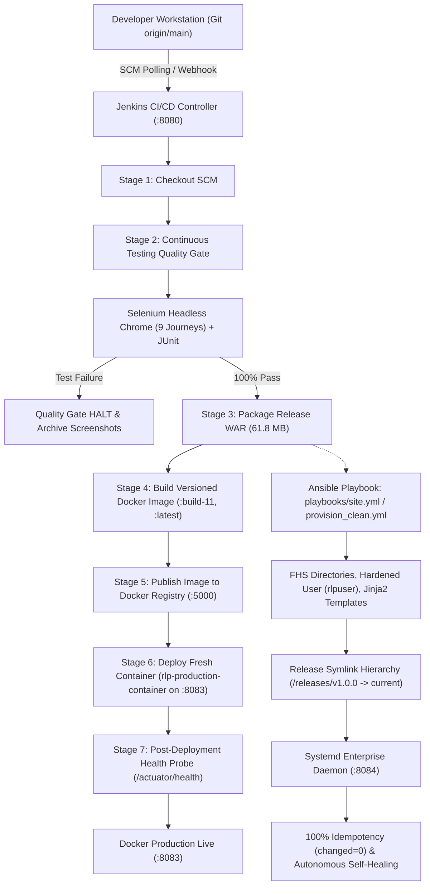

# Automated Reverse Logistics Management Portal — Enterprise DevOps Release

[](http://localhost:8080)
[](http://localhost:8083/actuator/health)
[](http://localhost:8084/actuator/health)
[](docs/TASK9-DELIVERY.md)
[]()

A full-stack, enterprise-grade Reverse Logistics Management Portal built with Java 17, Spring Boot, Spring Security, Thymeleaf, and H2 Persistent RDBMS, automated through a complete continuous delivery pipeline incorporating Git SCM, Jenkins Declarative Pipelines, Selenium WebDriver quality gates, Docker containerization with private registry publishing, and Ansible Infrastructure as Code with autonomous self-healing recovery.

**Student:** Soham Kholapure (Roll No. 23102A0064, BE CMPN A)  
**Academic Year:** 2026–2027  
**Repository Branch:** `main`  
**GitHub Remote:** [soham-Jain08/reverse-logistics-portal](https://github.com/soham-Jain08/reverse-logistics-portal.git)

---

## 1. 15-Task DevOps Lifecycle Scorecard (100% Completed)

| Sprint | Task ID | Task Title | Engineering Domain | Status | Key Deliverable & Artifact Reference |
|:---|:---|:---|:---|:---:|:---|
| **Sprint 1** | **TASK-01** | Problem Definition and Scope | Requirements & Planning | **DONE** | Scope specification, 15-task backlog, stakeholder analysis |
| | **TASK-02** | Agile Planning & DevOps Lifecycle | Agile Scrum & Architecture | **DONE** | Sprint board, DoD criteria, DevOps workflow blueprint |
| | **TASK-03** | Requirements, Architecture & Tech Setup | System Design & Prototyping | **DONE** | [SRS Summary](docs/SRS-summary.md), UML use cases, ER diagram, Spring Boot skeleton |
| | **TASK-04** | Git & GitHub Repository Initialization | SCM & Governance | **DONE** | GitHub repo, branch protection policies, PR templates, `.gitignore` |
| | **TASK-05** | Feature Development with Branching | Feature Engineering | **DONE** | Feature branch `feature/return-request`, PR #1, merge into `develop` |
| **Sprint 2** | **TASK-06** | MVP Completion & Git Collaboration | System Integration | **DONE** | [TASK6 Delivery](docs/TASK6-DELIVERY.md): Functional MVP, conflict resolution, release tag `v0.1.0` |
| | **TASK-07** | Jenkins Installation & CI Job | Continuous Integration | **DONE** | [TASK7 Delivery](docs/TASK7-DELIVERY.md): Jenkins setup, SCM polling (`H/5 * * * *`), archived WAR |
| | **TASK-08** | Pipeline as Code & Server Deployment | CI/CD Automation | **DONE** | [TASK8 Delivery](docs/TASK8-DELIVERY.md): Declarative `Jenkinsfile`, Tomcat deployment on port 8082 |
| | **TASK-09** | Selenium Test Design & Local Execution | Automated Quality Assurance | **DONE** | [TASK9 Delivery](docs/TASK9-DELIVERY.md): 9 Selenium user journeys, headless Chrome, screenshots |
| | **TASK-10** | Continuous Testing in Jenkins | Continuous Testing | **DONE** | [TASK10 Delivery](docs/TASK10-DELIVERY.md): Jenkins test quality gate, defect injection & correction |
| **Sprint 3** | **TASK-11** | Containerization with Docker | Containers & Packaging | **DONE** | [TASK11 Delivery](docs/TASK11-DELIVERY.md): Alpine JRE 17 Dockerfile, non-root user, healthcheck |
| | **TASK-12** | Jenkins-Docker Continuous Deployment | Continuous Deployment | **DONE** | [TASK12 Delivery](docs/TASK12-DELIVERY.md): Versioned image build (`:build-11`), local registry (:5000), port 8083 |
| | **TASK-13** | Configuration Management with Ansible | Infrastructure as Code | **DONE** | [TASK13 Delivery](docs/TASK13-DELIVERY.md): Ansible role, FHS directories, Jinja2 templates, port 8084 |
| | **TASK-14** | Automated Provisioning & Reliability | Reliability & Resilience | **DONE** | [TASK14 Delivery](docs/TASK14-DELIVERY.md): 100% idempotency (`changed=0`), rollback & self-healing |
| | **TASK-15** | Final Release, Documentation & Viva | Capstone Release & Viva | **DONE** | [TASK15 Delivery](docs/TASK15-DELIVERY.md): Master report, architecture, troubleshooting, and viva defense |

---

## 2. End-to-End DevOps Architecture



---

## 3. Dedicated Host Port Allocation Matrix

To prevent port collisions across running services, host ports are allocated strictly as follows:

| Port | Service Component | Runtime / Execution Target | Healthcheck Endpoint | Purpose / Role |
|:---:|:---|:---|:---|:---|
| **8080** | Jenkins CI/CD Controller | Host OS (Windows) | `http://localhost:8080/login` | Automated build orchestration, testing quality gate & CD. |
| **8081** | Standalone Dev Portal | Host OS (Windows) | `http://localhost:8081/actuator/health` | Active development server & target for local Selenium suite. |
| **8082** | Apache Tomcat 10.1 Server | Host OS (Windows) | `http://localhost:8082/reverse-logistics-portal/` | Traditional application server WAR deployment (Task 8). |
| **8083** | Production Docker Container | Docker Engine | `http://localhost:8083/actuator/health` | Containerized production release (`rlp-production-container`, Tasks 11-12). |
| **8084** | Enterprise Linux Node | WSL2 Ubuntu 26.04 | `http://localhost:8084/actuator/health` | Ansible-provisioned systemd daemon with self-healing recovery (Tasks 13-14). |
| **5000** | Private Docker Registry | Docker Engine | `http://localhost:5000/v2/_catalog` | Private registry storing versioned build images (`:build-11`, `:latest`). |

---

## 4. Key Functional Features

1. **Customer Self-Service Return Portal:**
   - Create Return Requests with dynamic RMA generation (`RMA-YYYYMMDD-XXXX`).
   - Track return status real-time (`PENDING`, `APPROVED`, `RECEIVED`, `RESTOCKED`).
   - Filter returns by status, reason, or date range.
2. **Return Manager Portal:**
   - Policy-driven return request authorization and rejection.
   - Manager comments, inspection guidelines, and refund approvals.
   - Aggregate return metrics and reason frequency analytics.
3. **Warehouse Operations & Inspection:**
   - Barcode/RMA scan-and-receive verification.
   - Physical grading (`NEW_UNOPENED`, `OPEN_BOX`, `DAMAGED`, `DEFECTIVE`).
   - Disposition management (`RESTOCK`, `REFURBISH`, `RECYCLE`, `SCRAP`).
4. **Compliance & Audit Logging:**
   - Immutable audit logging tracking every state transition with user identity, timestamp, and comments.

---

## 5. Quickstart & Execution Guide

### Prerequisites
* Java 17+ (JDK 17 or JDK 26)
* Maven 3.9+ (or use included `./mvnw`)
* Docker Engine 27+ (optional for container deployment)
* Ansible Core 2.20+ (optional for IaC provisioning)

### 1. Run Application Locally
```bash
git clone https://github.com/soham-Jain08/reverse-logistics-portal.git
cd reverse-logistics-portal
./mvnw clean spring-boot:run
```
Access portal at `http://localhost:8081`

### 2. Run Automated Testing Suite (Selenium & Unit Tests)
```bash
./mvnw clean test
```
* Generates Surefire JUnit XML reports in `target/surefire-reports/`.
* Captures failure screenshots automatically in `target/screenshots/` if any assertion fails.

### 3. Build & Run Production Docker Container
```bash
# Package executable WAR
./mvnw clean package -DskipTests

# Build and run Docker container
docker build -t reverse-logistics-portal:v1.0.0 .
docker run -d --name rlp-container -p 8083:8080 reverse-logistics-portal:v1.0.0
```
Verify container health:
```bash
curl http://localhost:8083/actuator/health
```

### 4. Provision Target Node with Ansible
```bash
cd ansible
ansible-playbook -i inventory/hosts.ini playbooks/provision_clean.yml
```
* Automatically provisions OS prerequisites, non-login user `rlpuser:rlpgroup`, FHS directories, and systemd service on port `8084`.
* Re-run immediately to verify **100% idempotency** (`changed=0`).

### 5. Execute Reliability & Recovery Validation Suite
```bash
cd ansible
ansible-playbook -i inventory/hosts.ini playbooks/test_reliability_recovery.yml
```
* Validates 4 stages: baseline health -> version upgrade -> operator rollback -> autonomous self-healing recovery upon candidate failure!

---

## 6. Project Documentation & Deliverable Links

* **Master Capstone & Viva Report:** [`docs/TASK15-DELIVERY.md`](docs/TASK15-DELIVERY.md)
* **Product Backlog & User Stories:** [`docs/backlog.md`](docs/backlog.md)
* **Selenium Test Plan:** [`docs/TASK9-TEST-PLAN.md`](docs/TASK9-TEST-PLAN.md)
* **Software Requirements Specification (SRS):** [`docs/SRS-summary.md`](docs/SRS-summary.md)
* **Pipeline as Code (`Jenkinsfile`):** [`Jenkinsfile`](Jenkinsfile)
* **Production Container Definition:** [`Dockerfile`](Dockerfile)
* **Ansible Infrastructure as Code:** [`ansible/playbooks/site.yml`](ansible/playbooks/site.yml)
