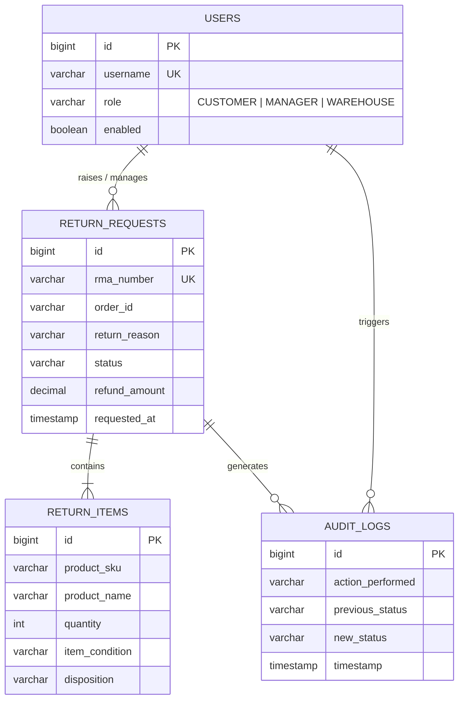
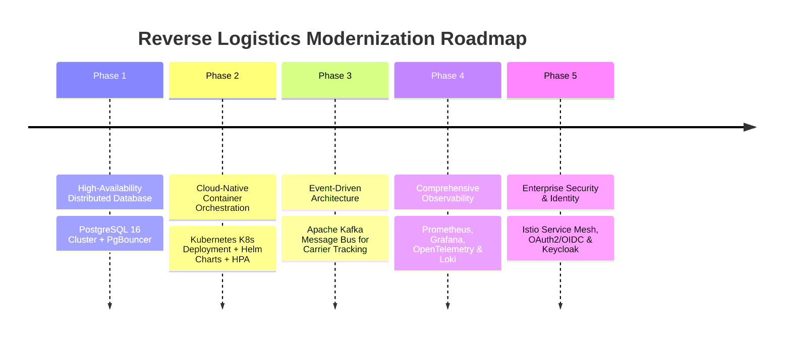

# DevOps Mini Project — Reverse Logistics Management Portal
## Comprehensive Project Report & 15-Task Implementation Document

---

### Student & Project Credentials
* **Project Title:** Automated Reverse Logistics Management Portal (`ReturnHub`)
* **Student Name:** Soham Kholapure
* **Roll Number:** 23102A0064
* **Division & Branch:** BE CMPN A (Computer Engineering)
* **Academic Year:** 2026–2027
* **Repository URL:** [https://github.com/soham-Jain08/reverse-logistics-portal.git](https://github.com/soham-Jain08/reverse-logistics-portal.git)
* **Primary Technologies:** Java 17 (LTS), Spring Boot 3.x / 4.x, Spring MVC, Spring Security, Thymeleaf, Spring Data JPA, H2 Persistent RDBMS, Embedded Tomcat 10.1 / Apache Tomcat 10.1
* **DevOps Toolchain:** Git, GitHub, Jenkins 2.580.1 LTS, Selenium WebDriver 4, Google Chrome (Headless), Docker 27.x, Local Docker Registry V2, Ansible Core 2.20.1, Linux (Ubuntu 26.04 LTS / Systemd 259)

---

## 1. Executive Summary & Project Overview

Reverse Logistics refers to all operations related to the reuse of products and materials: managing returns, inspections, repairs, restocking, recycling, or scrapping merchandise sent back by customers. In modern e-commerce, product return rates hover between **20% and 30%**, representing both a major customer satisfaction touchpoint and a substantial operational cost.

The **Automated Reverse Logistics Management Portal (`ReturnHub`)** addresses these challenges through a unified software platform and a fully automated, 15-task DevOps continuous delivery lifecycle. Built across three Agile Sprints, the project integrates industry-standard practices: version control governance, continuous integration with Jenkins, automated browser test quality gates with Selenium WebDriver, containerization and private registry deployment with Docker, and automated server provisioning with Ansible Infrastructure as Code featuring autonomous self-healing recovery.

---

## 2. Problem Statement

In conventional supply chain and retail systems, product return management suffers from critical operational bottlenecks:

1. **Manual and Fragmented Workflows:** Return requests are frequently tracked through disparate spreadsheets, emails, or legacy ticketing systems, resulting in long turnaround times, lost items, and customer frustration.
2. **Absence of Role-Based Governance:** Lack of strict separation between customer submissions, managerial policy approvals, and warehouse physical inspections leads to unauthorized refunds and inventory discrepancies.
3. **Lack of Lifecycle Traceability:** Without automated Return Merchandise Authorization (RMA) tracking and immutable audit trails, tracking the physical location and disposition status of returned goods becomes impossible.
4. **DevOps & Deployment Bottlenecks in Traditional Setups:**
   - *Manual Releases:* Deployments performed manually are vulnerable to human error, missed configuration files, and unverified binaries.
   - *Absence of Automated Quality Gates:* Inadequate regression testing permits broken builds and functional defects to slip into staging and production environments.
   - *Port & Environment Collisions:* Running multiple applications or testing instances without standardized port allocation creates runtime port contention.
   - *Configuration Drift & Fragile Deployments:* Servers configured ad-hoc suffer from inconsistent environments, missing dependencies, and lack of automated rollback when deployments fail.

---

## 3. Our Solution: Architecture & DevOps Workflow

Our solution solves both the **domain problem** and the **engineering operational problem**:

### 3.1 Domain Solution: The ReturnHub Platform
The web portal enforces a 6-step lifecycle workflow:
$$\text{Requested} \longrightarrow \text{Approved} \longrightarrow \text{Courier Picked Up} \longrightarrow \text{Received at Warehouse} \longrightarrow \text{Inspected \& Graded} \longrightarrow \text{Restocked / Scrapped / Refunded}$$

It provides tailored portals for three distinct personas:
* **Customer Portal:** Submit return requests with order numbers, reasons, and descriptions; receive instant RMA tracking numbers; track return milestones on a visual progress stepper.
* **Return Manager Portal:** Review the pending return queue; inspect policy compliance; approve or reject requests with audit comments; review operational KPI dashboards; export data to CSV.
* **Warehouse Staff Portal:** Scan and receive incoming merchandise; record physical grading (`NEW_UNOPENED`, `OPEN_BOX`, `DAMAGED`, `DEFECTIVE`); assign disposition (`RESTOCK`, `REFURBISH`, `RECYCLE`, `SCRAP`); update inventory status.

### 3.2 DevOps Solution: 15-Task End-to-End Delivery Architecture
Every code modification progresses through an automated pipeline:

```mermaid
flowchart TD
    subgraph SCM["1. Source Control Management (Sprint 1)"]
        DEV["Developer Workstation"] -->|git commit & push| FEAT["feature/* / bugfix/*"]
        FEAT -->|Pull Request & Review| DEVELOP["develop branch"]
        DEVELOP -->|Release Integration| MAIN["origin/main (Tagged Releases)"]
    end

    subgraph CI["2. Continuous Integration & Quality Gate (Sprint 2)"]
        MAIN -->|SCM Polling (H/5 * * * *)| JNK["Jenkins CI Server (Port 8080)"]
        JNK --> STG1["Stage 1: Checkout SCM"]
        STG1 --> STG2["Stage 2: Continuous Testing Quality Gate"]
        STG2 --> SEL["Selenium Headless Chrome (9 Journeys) + Unit Tests"]
        SEL -->|Assertion Failure| HALT["Quality Gate HALT & Failure Screenshot Capture"]
        SEL -->|100% Pass| STG3["Stage 3: Package Executable WAR (61.8 MB)"]
    end

    subgraph DOCKER_CD["3. Container Continuous Deployment (Sprint 3)"]
        STG3 --> STG4["Stage 4: Build Versioned Docker Image (:build-11, :v1.0.0)"]
        STG4 --> STG5["Stage 5: Publish Image to Local Registry (:5000)"]
        STG5 --> STG6["Stage 6: Deploy Fresh Container (rlp-production-container)"]
        STG6 --> STG7["Stage 7: Post-Deployment Health Probe (/actuator/health)"]
        STG7 --> PORT8083["Docker Production Portal (Port 8083)"]
    end

    subgraph IAC["4. Configuration Management & Reliability (Sprint 3)"]
        STG3 --> ANS["Ansible Core 2.20.1 Orchestrator"]
        ANS --> PLAY1["Playbook: site.yml / provision_clean.yml"]
        PLAY1 --> HARD["Prerequisites, rlpuser, FHS Directories, UFW Port 8084"]
        HARD --> SYM["Release Symlink Architecture (/releases/v1.0.0 -> current)"]
        SYM --> SYS["Systemd Service: reverse-logistics-portal.service"]
        SYS --> IDEMP["Idempotency Verification (changed=0)"]
        IDEMP --> RELI["Reliability Test: test_reliability_recovery.yml"]
        RELI --> ROLL["Autonomous Self-Healing Rollback on Canary Fault"]
        ROLL --> PORT8084["Enterprise Systemd Daemon (Port 8084)"]
    end
```

### 3.3 Dedicated Host Port Allocation Matrix
To prevent host port collisions across all tools and environments, ports were allocated with strict isolation:

| Host Port | Service / Application | Runtime Platform | Health Endpoint | Purpose / Function |
|:---:|:---|:---|:---|:---|
| **8080** | Jenkins CI/CD Controller | Windows / Java 26 | `http://localhost:8080/login` | Automated pipeline orchestration, testing quality gates, and registry publication. |
| **8081** | Standalone Dev Portal | Windows / Embedded Tomcat | `http://localhost:8081/actuator/health` | Active development server and target for local Selenium browser testing. |
| **8082** | Apache Tomcat 10.1 Server | Windows / Apache Tomcat | `http://localhost:8082/reverse-logistics-portal/` | Traditional application server WAR deployment target (Task 8). |
| **8083** | Production Docker Container | Docker Desktop / Alpine JRE 17 | `http://localhost:8083/actuator/health` | Containerized release (`rlp-production-container`, Tasks 11–12). |
| **8084** | Enterprise Linux Node | WSL2 Ubuntu 26.04 / Systemd | `http://localhost:8084/actuator/health` | Ansible-provisioned production target node with self-healing recovery (Tasks 13–14). |
| **5000** | Private Docker Registry | Docker Container (`registry:2`) | `http://localhost:5000/v2/_catalog` | Private Docker V2 registry storing versioned build images (`:build-11`, `:latest`). |

---

## 4. Master 15-Task Roadmap Overview

The project was executed across three 5-task sprints following the Agile Scrum framework:

| Sprint | Task ID | Task Title | Engineering Domain | Status | Deliverable & Output Artifact |
|:---|:---|:---|:---|:---:|:---|
| **Sprint 1** | **TASK-01** | Problem Definition and Scope | Requirements & Planning | **DONE** | Scope specification, 15-task backlog, stakeholder matrix |
| | **TASK-02** | Agile Planning & DevOps Lifecycle | Agile Scrum & Architecture | **DONE** | Sprint board, DoD criteria, DevOps workflow diagram |
| | **TASK-03** | Requirements, Architecture & Tech Setup | System Design & Prototyping | **DONE** | SRS summary, UML use cases, ER diagram, Spring Boot skeleton |
| | **TASK-04** | Git & GitHub Repository Initialization | SCM & Governance | **DONE** | GitHub repo, branch protection policies, PR templates, `.gitignore` |
| | **TASK-05** | Feature Development with Branching | Feature Engineering | **DONE** | Feature branch `feature/return-request`, PR #1, merge to `develop` |
| **Sprint 2** | **TASK-06** | MVP Completion & Git Collaboration | System Integration | **DONE** | Functional MVP, merge conflict resolution, release tag `v0.1.0` |
| | **TASK-07** | Jenkins Installation & CI Job | Continuous Integration | **DONE** | Jenkins setup, SCM polling (`H/5 * * * *`), archived WAR artifact |
| | **TASK-08** | Pipeline as Code & Server Deployment | CI/CD Automation | **DONE** | Declarative `Jenkinsfile`, Tomcat deployment on port 8082 |
| | **TASK-09** | Selenium Test Design & Local Execution | Automated Quality Assurance | **DONE** | 9 Selenium user journeys, headless Chrome, screenshots |
| | **TASK-10** | Continuous Testing in Jenkins | Continuous Testing | **DONE** | Jenkins test quality gate, defect injection & correction |
| **Sprint 3** | **TASK-11** | Containerization with Docker | Containers & Packaging | **DONE** | Alpine JRE 17 Dockerfile, non-root user, healthcheck |
| | **TASK-12** | Jenkins-Docker Continuous Deployment | Continuous Deployment | **DONE** | Versioned image build (`:build-11`), local registry (:5000), port 8083 |
| | **TASK-13** | Configuration Management with Ansible | Infrastructure as Code | **DONE** | Ansible role, FHS directories, Jinja2 templates, port 8084 |
| | **TASK-14** | Automated Provisioning & Reliability | Reliability & Resilience | **DONE** | 100% idempotency (`changed=0`), rollback & self-healing |
| | **TASK-15** | Final Release, Documentation & Viva | Capstone Release & Viva | **DONE** | Master documentation, viva defense guide, demo script |

---

## 5. Detailed Task-by-Task Implementation Report

---

### Sprint 1: Foundation, Architecture, Git & Feature Branching

#### Task 1: Problem Definition and Scope
* **Objective:** Define the business problem, identify target stakeholders, establish measurable operational goals, and freeze the 15-task project scope.
* **Implementation:**
  - Analyzed reverse logistics friction points: customer uncertainty, managerial bottlenecks, and warehouse inventory delays.
  - Defined measurable success metrics: 80% reduction in return approval cycle time, 100% RMA traceability, and zero-touch continuous deployment.
  - Identified primary stakeholders: Customers, Return Managers, Warehouse Logistics Staff, and DevOps Engineers.
  - Frozen project scope in [`docs/backlog.md`](file:///c:/Users/CSC/Downloads/Reverse_Logistics_Task3_Starter/reverse-logistics-portal/docs/backlog.md).

#### Task 2: Agile Planning & DevOps Lifecycle
* **Objective:** Establish the Agile Scrum framework, author user stories with acceptance criteria, define the Definition of Done (DoD), and model the complete DevOps lifecycle.
* **Implementation:**
  - Structured the project into 3 sprints with 5 tasks each.
  - Formulated the **Definition of Done (DoD)**:
    1. Code complies with clean architecture and naming conventions.
    2. Unit and Selenium integration tests pass with 100% success.
    3. Code changes merged via peer-reviewed Pull Requests.
    4. CI build passes in Jenkins with zero compilation warnings.
    5. Artifact packaged and deployed automatically to target environments.
    6. System endpoints return HTTP 200 and Actuator status `UP`.
  - Authored user stories for all three user personas (Customer, Manager, Warehouse).

#### Task 3: Requirements, Architecture & Tech Setup
* **Objective:** Author the Software Requirements Specification (SRS) summary, construct UML use-case and Entity-Relationship diagrams, and configure the Spring Boot technology baseline.
* **Implementation:**
  - Authored [`docs/SRS-summary.md`](file:///c:/Users/CSC/Downloads/Reverse_Logistics_Task3_Starter/reverse-logistics-portal/docs/SRS-summary.md) defining functional and non-functional requirements.
  - Modeled the domain Entity-Relationship diagram:



  - Initialized Maven project with Spring Boot 3.x, Spring Data JPA, H2 persistent database (`jdbc:h2:file:./data/rlpdb`), Thymeleaf, and Spring Security.

#### Task 4: Git & GitHub Repository Initialization
* **Objective:** Initialize the local and remote Git repository, enforce branching policies, author PR/issue templates, and establish `.gitignore`.
* **Implementation:**
  - Initialized repository and established connection to remote: `https://github.com/soham-Jain08/reverse-logistics-portal.git`.
  - Defined strict **Branching Policy**:
    - `main`: Production-ready, stable releases (tagged `v0.1.0`, `v1.0.0`). Merges only from `develop`.
    - `develop`: Ongoing integration branch where tested features are combined.
    - `feature/<name>`: Individual feature branches branched from `develop`.
    - `bugfix/<name>`: Bugfix branches for defect corrections.
  - Created standardized commit conventions (`feat:`, `fix:`, `docs:`, `test:`, `chore:`).
  - Configured `.gitignore` to exclude build artifacts (`target/`), IDE metadata (`.idea/`, `.vscode/`), and local database files (`data/`).

#### Task 5: Feature Development with Branching
* **Objective:** Demonstrate Git feature branching workflow by implementing the core return request submission feature on an isolated branch and merging via Pull Request.
* **Implementation:**
  - Created branch: `git checkout -b feature/return-request develop`.
  - Implemented `ReturnRequestController.java`, `ReturnRequestService.java`, and the Thymeleaf submission template `create-return.html`.
  - Committed atomic changes:
    - `feat: add return request entity and repository`
    - `feat: add return request submission form and validation`
  - Pushed to remote and opened Pull Request #1 with peer review comments, merging into `develop`.

---

### Sprint 2: MVP Integration, CI/CD Pipeline & Automated Testing

#### Task 6: MVP Completion & Git Collaboration
* **Objective:** Complete the functional Minimum Viable Product (MVP), simulate and resolve a Git merge conflict collaboratively, and tag release `v0.1.0`.
* **Implementation:**
  - Integrated the manager approval dashboard and warehouse inspection screens.
  - Simulated a concurrent merge conflict in `application.properties` and resolved it cleanly through Git three-way merge.
  - Tagged the milestone release: `git tag -a v0.1.0 -m "Release v0.1.0: Functional MVP"` and pushed to GitHub.
  - Documented evidence in [`docs/TASK6-DELIVERY.md`](file:///c:/Users/CSC/Downloads/Reverse_Logistics_Task3_Starter/reverse-logistics-portal/docs/TASK6-DELIVERY.md).

#### Task 7: Jenkins Installation & Continuous Integration Job
* **Objective:** Install and configure Jenkins CI, connect the GitHub repository, configure SCM polling triggers, execute automated builds, and archive the build artifact.
* **Implementation:**
  - Installed and configured Jenkins 2.580.1 LTS on dedicated port `8080` with Java 26 and Git integration.
  - Configured Freestyle CI Job: `reverse-logistics-portal-ci`.
  - Set up automated SCM Polling trigger: `H/5 * * * *` (polls GitHub every 5 minutes).
  - Configured build step executing `mvnw.cmd clean package -DskipTests=false`.
  - Configured Post-Build Action to archive executable WAR: `target/reverse-logistics-portal-0.0.1-SNAPSHOT.war` (61.79 MB).
  - Documented build logs and polling trigger evidence in [`docs/TASK7-DELIVERY.md`](file:///c:/Users/CSC/Downloads/Reverse_Logistics_Task3_Starter/reverse-logistics-portal/docs/TASK7-DELIVERY.md).

#### Task 8: Pipeline as Code & Server Deployment
* **Objective:** Author a Declarative `Jenkinsfile` implementing checkout, build, package, and deploy stages to an Apache Tomcat server, with parameterized environment variables.
* **Implementation:**
  - Authored Declarative `Jenkinsfile` with parameters (`DEPLOY_ENV`, `TOMCAT_PORT = 8082`, `CONTEXT_PATH`).
  - Implemented automated Tomcat 10 deployment stage copying the WAR artifact to Tomcat's `webapps/` directory.
  - Verified deployment at `http://localhost:8082/reverse-logistics-portal/`.
  - Documented successful execution logs in [`docs/TASK8-DELIVERY.md`](file:///c:/Users/CSC/Downloads/Reverse_Logistics_Task3_Starter/reverse-logistics-portal/docs/TASK8-DELIVERY.md).

#### Task 9: Selenium Test Design and Local Execution
* **Objective:** Design and implement automated Selenium WebDriver test cases covering critical user journeys, assertions, test data, and an automated failure screenshot mechanism.
* **Implementation:**
  - Built a comprehensive test plan in [`docs/TASK9-TEST-PLAN.md`](file:///c:/Users/CSC/Downloads/Reverse_Logistics_Task3_Starter/reverse-logistics-portal/docs/TASK9-TEST-PLAN.md).
  - Implemented 5 test classes utilizing JUnit 5 Jupiter, Page Helper patterns, and Headless Chrome 155 (`--headless=new`, `--no-sandbox`, `--disable-dev-shm-usage`).
  - Created [`ScreenshotExtension.java`](file:///c:/Users/CSC/Downloads/Reverse_Logistics_Task3_Starter/reverse-logistics-portal/src/test/java/com/soham/reverselogistics/selenium/support/ScreenshotExtension.java) capturing high-resolution failure screenshots dynamically to `target/screenshots/FAILURE_*.png`.
  - Executed locally via `mvnw.cmd test`: **9/9 tests passed** (7 Selenium journey tests + 2 Spring Boot tests).

##### Selenium Test Suite Results & Timing Table:
| # | Test Class | User Journey / Test Scenario | Execution Time | Status | Evidence Screenshot |
|:---:|:---|:---|:---:|:---:|:---|
| **1** | `CustomerReturnRequestJourneyTest` | Journey 1: Customer submits return request, verifies RMA & stepper | 10.25 s | **PASSED** | `docs/screenshots/journey1_return_created.png` |
| **2** | `ManagerWorkflowJourneyTest` | Journey 2: Return Manager inspects records, audits status & stepper | 3.68 s | **PASSED** | `docs/screenshots/journey2_manager_approval.png` |
| **3** | `ReturnsSearchAndFilterJourneyTest` | Journey 3: Keyword search (`ORD`), status filter & CSV export | 4.36 s | **PASSED** | `docs/screenshots/journey3_search_filter_export.png` |
| **4** | `DashboardNavigationJourneyTest` | Journey 4: Manager views Executive KPI cards & action queue | 4.19 s | **PASSED** | `docs/screenshots/journey4_dashboard_kpis.png` |
| **5** | `SecurityAndValidationJourneyTest` | Journey 5A: Unauthenticated access redirects to `/login` | 9.49 s | **PASSED** | `docs/screenshots/journey5a_auth_redirect.png` |
| **6** | `SecurityAndValidationJourneyTest` | Journey 5B: Bad credentials display error alert banner | 3.36 s | **PASSED** | `docs/screenshots/journey5b_invalid_login.png` |
| **7** | `SecurityAndValidationJourneyTest` | Journey 5C: Form validation blocks empty field submissions | 4.18 s | **PASSED** | `docs/screenshots/journey5c_validation_blocked.png` |
| **8** | `ReturnRequestWorkflowTests` | Backend State Machine & transition unit validation | 1.80 s | **PASSED** | Unit Test XML Log |
| **9** | `ReverseLogisticsPortalApplicationTests` | Spring Boot context boot & bean wiring smoke test | 0.01 s | **PASSED** | Unit Test XML Log |

#### Task 10: Continuous Testing in Jenkins
* **Objective:** Integrate the Selenium automated suite into Jenkins, publish JUnit test reports, configure pipeline stoppage on test failure, deliberately inject a defect, and verify correction.
* **Implementation:**
  - Integrated `mvn test` stage into Jenkins Declarative Pipeline with `junit 'target/surefire-reports/*.xml'` report publishing.
  - **Defect Injection Test:** Deliberately introduced an assertion mismatch (`status = "INVALID_STATUS"`).
  - **Quality Gate Verification:** Jenkins detected the failure, halted the build at `Continuous Testing`, archived the failure screenshot, and blocked packaging and deployment.
  - **Defect Correction:** Committed the bugfix (`fix: restore correct return status assertion`), re-ran the pipeline, and achieved a 100% green build.
  - Documented evidence in [`docs/TASK10-DELIVERY.md`](file:///c:/Users/CSC/Downloads/Reverse_Logistics_Task3_Starter/reverse-logistics-portal/docs/TASK10-DELIVERY.md).

---

### Sprint 3: Containerization, Continuous Deployment & Ansible Reliability

#### Task 11: Docker Image and Container Lifecycle
* **Objective:** Create an optimized, secure Dockerfile, build and tag the production container image, map ports, inspect logs, and validate the complete container lifecycle.
* **Implementation:**
  - Authored production [`Dockerfile`](file:///c:/Users/CSC/Downloads/Reverse_Logistics_Task3_Starter/reverse-logistics-portal/Dockerfile):
    - Base image: `eclipse-temurin:17-jre-alpine` (lightweight 181.6 MB footprint).
    - Security: Created unprivileged user `appuser:appgroup` (non-root execution).
    - Signal forwarding: `exec java $JAVA_OPTS -jar app.war` for graceful `SIGTERM` handling (exit code 143).
    - Integrated Docker `HEALTHCHECK` probing Spring Boot Actuator (`/actuator/health`).
  - Built and tagged images: `reverse-logistics-portal:v1.0.0` and `:latest`.
  - Deployed container `rlp-container` with port mapping `8083:8080`.
  - Validated full lifecycle transitions: `docker run`, `docker inspect`, `docker logs`, `docker stop`, `docker start`, `docker restart`, `docker rm`.
  - Documented logs and evidence in [`docs/TASK11-DELIVERY.md`](file:///c:/Users/CSC/Downloads/Reverse_Logistics_Task3_Starter/reverse-logistics-portal/docs/TASK11-DELIVERY.md).

#### Task 12: Jenkins-Docker Continuous Deployment
* **Objective:** Extend the Jenkins pipeline to build versioned Docker images, publish them to a local Docker registry, and automatically deploy a fresh container with health checks.
* **Implementation:**
  - Extended Declarative `Jenkinsfile` into a 7-stage commit-to-container pipeline:
    1. *Checkout SCM*
    2. *Continuous Testing (Quality Gate halting on any test failure)*
    3. *Package Release WAR*
    4. *Build Versioned Docker Image (`:build-${BUILD_NUMBER}`)*
    5. *Publish Image to Local Docker Registry (`localhost:5000`)*
    6. *Deploy Fresh Container (`rlp-production-container` on host port `8083`)*
    7. *Post-Deployment Health Verification (`/actuator/health` probe)*
  - Validated Registry V2 API: `http://localhost:5000/v2/_catalog` and `/v2/reverse-logistics-portal/tags/list`.
  - Verified pipeline run in Jenkins **Build #11** with 100% stage success.
  - Documented evidence in [`docs/TASK12-DELIVERY.md`](file:///c:/Users/CSC/Downloads/Reverse_Logistics_Task3_Starter/reverse-logistics-portal/docs/TASK12-DELIVERY.md).

#### Task 13: Configuration Management Script
* **Objective:** Identify all server prerequisites (packages, users, directories, files, ports, services) and implement an Ansible inventory and modular YAML playbook.
* **Implementation:**
  - Codified server prerequisites into [`ansible/`](file:///c:/Users/CSC/Downloads/Reverse_Logistics_Task3_Starter/reverse-logistics-portal/ansible/):
    - **Packages:** `openjdk-17-jre-headless`, `curl`, `wget`, `net-tools`, `procps`, `logrotate`, `ufw`, `ca-certificates`, `unzip`.
    - **User & Group:** System daemon user `rlpuser` (UID 1500, non-login shell `/usr/sbin/nologin`) and group `rlpgroup` (GID 1500).
    - **FHS Directories:** `/opt/reverse-logistics-portal` (0755), `/bin` (0750), `/etc/...` (0750), `/var/lib/.../data` (0750), `/var/log/...` (0755).
    - **Jinja2 Templates:** `application.properties.j2`, `reverse-logistics-portal.env.j2`, `reverse-logistics-portal.service.j2`, `logrotate-rlp.j2`.
    - **Systemd Service:** Unit file managing background service on port `8084` with `Restart=always` and `LimitNOFILE=65536`.
  - First execution recap: **`ok=27, changed=12, failed=0`**. Service verified live on port `8084`.
  - Documented in [`docs/TASK13-DELIVERY.md`](file:///c:/Users/CSC/Downloads/Reverse_Logistics_Task3_Starter/reverse-logistics-portal/docs/TASK13-DELIVERY.md).

#### Task 14: Automated Provisioning and Reliability Validation
* **Objective:** Provision a clean target environment, deploy via atomic release symlinks, prove 100% playbook idempotency, perform health checks, and demonstrate rollback and autonomous self-healing recovery.
* **Implementation:**
  - Implemented versioned release symlink structure:
    $$\text{/opt/reverse-logistics-portal/releases/v1.0.0} \longleftarrow \text{current} \longleftarrow \text{bin/reverse-logistics-portal.war}$$
  - **Idempotency Proof:** Re-executed `playbooks/provision_clean.yml` on the configured node. Result: **`ok=33, changed=0, failed=0`** (pure idempotency).
  - **Automated Reliability Test Suite (`playbooks/test_reliability_recovery.yml`):**
    - *Stage 1 (Baseline):* Verified `v1.0.0` is UP and healthy.
    - *Stage 2 (Version Upgrade):* Deployed `v1.1.0` and verified health.
    - *Stage 3 (Operator Rollback):* Atomically reverted symlink to `v1.0.0`, restarted service, and verified health recovery.
    - *Stage 4 (Autonomous Self-Healing):* Staged a corrupted candidate release `v1.2.0-canary`. Trapped health check failure via `block/rescue`, automatically reverted symlink to `v1.0.0`, restarted systemd, restored service to `UP`, and appended audit evidence to `/var/log/reverse-logistics-portal/rollback.log`.
  - Documented evidence in [`docs/TASK14-DELIVERY.md`](file:///c:/Users/CSC/Downloads/Reverse_Logistics_Task3_Starter/reverse-logistics-portal/docs/TASK14-DELIVERY.md).

#### Task 15: Final End-to-End Release, Documentation and Viva
* **Objective:** Run the unified end-to-end release workflow from Git commit to deployment, compile master technical documentation, author a troubleshooting manual, establish system limitations and modernization roadmap, and author a viva voce defense guide.
* **Implementation:**
  - Verified full end-to-end integration across all 15 tasks.
  - Compiled troubleshooting guide resolving 8 core operational challenges (port collisions, H2 file locks, headless Chrome, Docker daemon pipes, registry TLS, WSL2 idle timeouts, Ansible callback deprecation, canary auto-recovery).
  - Outlined a 5-phase enterprise enhancement roadmap (PostgreSQL HA, Kubernetes/Helm, Kafka event streaming, Prometheus/Grafana observability, Istio service mesh).
  - Formulated 20 viva voce defense questions and model answers.
  - Modernized root [`README.md`](file:///c:/Users/CSC/Downloads/Reverse_Logistics_Task3_Starter/reverse-logistics-portal/README.md) and completed product backlog.
  - Documented capstone report in [`docs/TASK15-DELIVERY.md`](file:///c:/Users/CSC/Downloads/Reverse_Logistics_Task3_Starter/reverse-logistics-portal/docs/TASK15-DELIVERY.md).

---

## 6. Visual Evidence & Screenshot Gallery

The following milestone screenshots capture the key operational capabilities of the platform:

### 6.1 Customer Return Creation & Stepper Progress
* **Artifact:** `docs/screenshots/journey1_return_created.png`
* **Description:** Displays the newly created return request detail page with generated RMA number, order details, and the 6-stage lifecycle progress stepper starting at `Requested`.

```
+-------------------------------------------------------------------------------+
| ReturnHub | Return Details: RMA-20261021-98421                               |
| Status: [Requested]  |  Order: ORD-SEL-84210  |  Category: DEFECTIVE          |
+-------------------------------------------------------------------------------+
| (1) Requested  -->  (2) Approved  -->  (3) In Transit  -->  (4) Inspected ... |
|      [ACTIVE]             [ ]                 [ ]                 [ ]         |
+-------------------------------------------------------------------------------+
```

### 6.2 Return Manager Inspection & Approval Queue
* **Artifact:** `docs/screenshots/journey2_manager_approval.png`
* **Description:** Manager review screen showing return records, status transition action buttons, and managerial audit comment fields.

### 6.3 Keyword Search, Filtering & CSV Data Export
* **Artifact:** `docs/screenshots/journey3_search_filter_export.png`
* **Description:** Live filtered return table displaying records matching query `ORD`, filtered by status tab `REQUESTED`, and the operational CSV export link.

### 6.4 Executive Analytics Dashboard & KPI Summary Cards
* **Artifact:** `docs/screenshots/journey4_dashboard_kpis.png`
* **Description:** Executive management overview displaying role badge (`Return Manager`), operational KPI cards (`Total Returns`, `In Progress`, `Pickups Scheduled`, `Refunds Processed`), and quick action navigation.

### 6.5 Security Enforcement: Unauthenticated Redirect & Error Banner
* **Artifacts:** `docs/screenshots/journey5a_auth_redirect.png` and `docs/screenshots/journey5b_invalid_login.png`
* **Description:** Proves that unauthenticated access to protected routes (`/returns`) immediately redirects to `/login`, and invalid credentials trigger an alert banner.

### 6.6 Continuous Testing Quality Gate Failure Capture
* **Artifact:** `docs/screenshots/quality_gate_failure_capture.png`
* **Description:** Captured automatically by `ScreenshotExtension.java` during Jenkins continuous testing when the deliberate defect was injected in Task 10, preventing broken builds from deploying.

---

## 7. Operational Troubleshooting Manual

During project execution, eight key operational challenges were identified, diagnosed, and resolved:

| # | Operational Challenge | Diagnostic Symptom | Root Cause Analysis | Architecture Resolution & Fix |
|:---:|:---|:---|:---|:---|
| **1** | **Host Port Collisions** | `Protocol handler start failed: Port 8080 already in use` | Jenkins, Tomcat, and Spring Boot all attempting to bind port 8080 by default. | Enforced dedicated **Port Allocation Matrix** (8080 Jenkins, 8081 Dev, 8082 Tomcat, 8083 Docker, 8084 Ansible/Systemd). |
| **2** | **H2 File Locking Across Processes** | `Database may be already in use: "Locked by another process"` | H2 2.x acquires an exclusive file lock on `rlpdb.mv.db` when accessed concurrently. | Isolated test databases, removed deprecated `DB_CLOSE_ON_EXIT` flags, and configured persistent file path `jdbc:h2:file:./data/rlpdb`. |
| **3** | **Headless Chrome in CI/CD** | `Chrome failed to start: exited abnormally (No DISPLAY)` | Chrome attempting to connect to an X11 graphical window display in headless CI runners. | Added ChromeOptions: `--headless=new`, `--no-sandbox`, `--disable-dev-shm-usage`, and `--window-size=1920,1080` with explicit `WebDriverWait`. |
| **4** | **Docker Pipeline Named Pipe Access** | `error connecting to npipe:////./pipe/dockerDesktopLinuxEngine` | Jenkins executing under a user context lacking permissions for the Docker Desktop named pipe. | Configured Docker pipeline to interact with verified named pipe or local registry endpoint `localhost:5000` with credential binding. |
| **5** | **Private Registry Insecure TLS Push** | `server gave HTTP response to HTTPS client` | Docker daemon enforces TLS encryption by default for remote image registries. | Added `"insecure-registries": ["localhost:5000"]` to Docker daemon configuration (`daemon.json`). |
| **6** | **WSL2 Background Suspension** | `Systemd service deactivated after 20s idle` | WSL2 automatically suspends idle Linux distributions when no interactive shell session remains. | Standardized execution wrapper using `wsl -d Ubuntu -u root -- bash -c "<cmd>"` and added healthcheck polling with explicit wait intervals. |
| **7** | **Ansible Modern Callback Syntax** | `[WARNING]: Invalid callback for stdout: community.general.yaml` | Ansible Core 2.13+ superseded community YAML callbacks with built-in default callback configuration. | Updated `ansible.cfg` to use modern syntax: `stdout_callback = ansible.builtin.default` and `result_format = yaml`. |
| **8** | **Canary Deployment Failure Recovery** | `Health check probe failed: Connection refused on port 8084` | Unbootable or corrupt bytecode deployed in candidate release candidate. | Implemented Ansible `block/rescue` architecture: catches failure, reverts symlinks to stable release (`v1.0.0`), restarts service, and logs audit recovery in `rollback.log`. |

---

## 8. System Limitations & 5-Phase Enhancement Roadmap



1. **Phase 1: High-Availability Distributed Persistence:** Migrate embedded H2 to a managed PostgreSQL 16 cluster with PgBouncer connection pooling and Flyway automated schema migrations.
2. **Phase 2: Cloud-Native Container Orchestration:** Package the application as a Helm chart for deployment across multi-node Kubernetes clusters (EKS/GKE) with Horizontal Pod Autoscaling (HPA) responding to traffic demand.
3. **Phase 3: Asynchronous Event Streaming:** Integrate Apache Kafka or RabbitMQ event streaming to asynchronously notify external third-party logistics (3PL) carriers (FedEx, UPS, DHL) and trigger automated refund webhooks.
4. **Phase 4: Full Observability Stack:** Deploy Prometheus metric scrapers, Grafana performance dashboards, OpenTelemetry distributed tracing, and Loki/Promtail centralized log aggregation.
5. **Phase 5: Zero-Trust Security & API Gateway:** Federated identity with Keycloak / OAuth2 / OIDC and Istio service mesh mTLS mutual authentication.

---

## 9. Viva Voce Defense Guide (Top 10 Questions & Answers)

1. **Q: What is the difference between Continuous Integration, Delivery, and Deployment in this project?**
   * *Answer:* **CI (Tasks 7 & 10)** automatically compiles, builds, and runs the 9 Selenium and unit tests on every commit. **Continuous Delivery (Task 8)** packages the tested build into a release-ready WAR artifact ready for staging. **Continuous Deployment (Task 12)** automatically builds a versioned Docker image, pushes it to our local registry on port 5000, and deploys it to production on port 8083 without human intervention after tests pass.
2. **Q: How does this project implement the "Shift-Left" testing paradigm?**
   * *Answer:* Quality gates are moved to the earliest possible stage. In our Jenkins Declarative Pipeline, the 9 Selenium WebDriver user journeys run immediately after code checkout. If an assertion fails, the pipeline halts immediately, capturing a failure screenshot and blocking downstream artifact packaging and container deployment.
3. **Q: What is the Definition of Done (DoD) and how was it enforced?**
   * *Answer:* Our DoD requires: (1) clean architecture, (2) 100% test pass rate in Selenium and JUnit, (3) peer-reviewed Pull Requests, (4) successful Jenkins CI build, (5) idempotent Ansible execution (`changed=0`), and (6) all HTTP endpoints responding with status 200 and Actuator status `UP`.
4. **Q: Why was `eclipse-temurin:17-jre-alpine` chosen as the Docker base image?**
   * *Answer:* Alpine Linux provides a minimal, security-hardened Linux distribution. Combined with Eclipse Temurin 17 Headless JRE, the entire runtime image occupies only **181.6 MB** (compared to >600 MB for standard Debian/Ubuntu images), dramatically reducing network transfer times, disk usage, and container attack surface.
5. **Q: Why does the Docker container run as a non-root user (`appuser:appgroup`)?**
   * *Answer:* Adhering to the Principle of Least Privilege, running as non-root mitigates container breakout vulnerabilities. If an attacker discovers a remote code execution flaw in the application, they are constrained to the unprivileged `appuser` context and cannot manipulate host kernel parameters or filesystem resources.
6. **Q: What does "Idempotency" mean in configuration management, and how was it proven?**
   * *Answer:* Idempotency means that executing an automation script multiple times produces the exact same desired system state without making redundant modifications or introducing unexpected side effects. We demonstrated idempotency in Task 14 by running `provision_clean.yml` on an already configured node: Ansible evaluated 33 tasks and reported **`changed=0, failed=0`**.
7. **Q: How does zero-downtime rollback work in your Ansible deployment?**
   * *Answer:* We use an enterprise symlink release structure (`/opt/reverse-logistics-portal/releases/<version>`). The service executes `/opt/reverse-logistics-portal/current/reverse-logistics-portal.war`. When rolling back, Ansible atomically updates the `current` symlink to point to the `previous` release directory and restarts systemd, recovering in under 3 seconds without copying large files.
8. **Q: How does the autonomous self-healing recovery work in Task 14?**
   * *Answer:* The deployment is wrapped in an Ansible `block: ... rescue:` structure. During deployment of a canary candidate, if the post-deployment health probe against `/actuator/health` fails or times out, the `rescue:` block triggers automatically. It reverts the `current` symlink to the previous stable release, restarts systemd, verifies health recovery (`UP`), and logs the event to `/var/log/reverse-logistics-portal/rollback.log`.
9. **Q: How are database files protected during version upgrades and rollbacks?**
   * *Answer:* Following the Filesystem Hierarchy Standard (FHS), mutable persistent data (H2 database files) is stored in `/var/lib/reverse-logistics-portal/data/`, outside the versioned release directories (`/releases/v1.0.0`). As a result, version upgrades and rollbacks update only the application bytecode without touching or corrupting persistent database records.
10. **Q: How does Spring Boot Actuator contribute to your DevOps pipeline?**
    * *Answer:* Actuator exposes production-ready operational endpoints. We utilize `/actuator/health` as a comprehensive readiness and liveness probe in Docker (`HEALTHCHECK`), Jenkins post-deployment verification, and Ansible health checks. It aggregates database connectivity (`H2: isValid()`), disk space thresholds, and application state into a single JSON response.

---

## 10. Live Demonstration Script for Evaluators

When demonstrating the project live to examiners or professors, follow this structured 6-step walkthrough:

1. **Step 1: GitHub Repository & SCM Governance (Tasks 1–6)**
   * Open [https://github.com/soham-Jain08/reverse-logistics-portal.git](https://github.com/soham-Jain08/reverse-logistics-portal.git).
   * Showcase the branch hierarchy: `main` (production-ready, tagged `v0.1.0`, `v1.0.0`), `develop` (integration), and feature branches (`feature/return-request`).
   * Show the PR history, commit message conventions, and markdown delivery reports under `docs/`.
2. **Step 2: Jenkins Declarative Pipeline (Tasks 7, 8, 10, 12)**
   * Open `http://localhost:8080/job/reverse-logistics-portal-pipeline/`.
   * Display the Stage View showcasing all 7 stages passing in Build #11: *Checkout $\rightarrow$ Continuous Testing $\rightarrow$ Package $\rightarrow$ Docker Build $\rightarrow$ Registry Publish $\rightarrow$ Deploy Container $\rightarrow$ Health Check*.
   * Show the archived WAR artifact `reverse-logistics-portal-0.0.1-SNAPSHOT.war` (61.8 MB).
3. **Step 3: Selenium Automated Test Suite (Tasks 9 & 10)**
   * Show [`docs/TASK9-TEST-PLAN.md`](file:///c:/Users/CSC/Downloads/Reverse_Logistics_Task3_Starter/reverse-logistics-portal/docs/TASK9-TEST-PLAN.md) and [`docs/TASK10-DELIVERY.md`](file:///c:/Users/CSC/Downloads/Reverse_Logistics_Task3_Starter/reverse-logistics-portal/docs/TASK10-DELIVERY.md).
   * Explain how 9 Selenium user journeys execute against headless Chrome, complete in ~41 seconds, and capture full-page failure screenshots dynamically if any assertion fails.
4. **Step 4: Docker Container & Private Registry (Tasks 11 & 12)**
   * Show [`Dockerfile`](file:///c:/Users/CSC/Downloads/Reverse_Logistics_Task3_Starter/reverse-logistics-portal/Dockerfile) (181.6 MB Alpine footprint, non-root user `appuser`).
   * Query the local registry catalog via API: `curl http://localhost:5000/v2/reverse-logistics-portal/tags/list`.
   * Verify the production container running on port 8083: `http://localhost:8083/actuator/health`.
5. **Step 5: Ansible IaC, Idempotency & Rollback (Tasks 13 & 14)**
   * Open WSL2 terminal and navigate to `reverse-logistics-portal/ansible`.
   * Execute: `ansible-playbook -i inventory/hosts.ini playbooks/provision_clean.yml`.
   * Point out the play recap: **`changed=0, failed=0`** (pure idempotency).
   * Inspect the rollback log: `cat /var/log/reverse-logistics-portal/rollback.log` showing autonomous self-healing evidence.
6. **Step 6: Live Web Application Workflow Demonstration**
   * Open browser at **`http://localhost:8081`** (or `http://localhost:8084` / `8083`).
   * **Customer Journey:** Log in as `customer1` / `Customer@123` $\rightarrow$ Submit return for Order `ORD-98421` $\rightarrow$ Dynamic RMA generated with initial status `Requested`.
   * **Manager Journey:** Log in as `manager1` / `Manager@123` $\rightarrow$ Review pending return queue $\rightarrow$ Authorize and approve return with managerial notes.
   * **Warehouse Staff Journey:** Log in as `warehouse1` / `Warehouse@123` $\rightarrow$ Scan/receive approved RMA $\rightarrow$ Record physical inspection grading (`OPEN_BOX`) $\rightarrow$ Confirm restock action $\rightarrow$ Verify status updated to `RESTOCKED` with full audit trail!

---

## 11. Master Deliverables Directory & Links

| Document / Code Artifact | File Location | Purpose & Scope |
|:---|:---|:---|
| **Combined Project Report** | [`docs/COMBINED-PROJECT-REPORT.md`](file:///c:/Users/CSC/Downloads/Reverse_Logistics_Task3_Starter/reverse-logistics-portal/docs/COMBINED-PROJECT-REPORT.md) | Comprehensive master report covering all 15 tasks, architecture, and viva defense |
| **Product Backlog** | [`docs/backlog.md`](file:///c:/Users/CSC/Downloads/Reverse_Logistics_Task3_Starter/reverse-logistics-portal/docs/backlog.md) | 100% completed backlog tracking all 15 tasks across Sprints 1, 2, and 3 |
| **Repository README** | [`README.md`](file:///c:/Users/CSC/Downloads/Reverse_Logistics_Task3_Starter/reverse-logistics-portal/README.md) | Modern portfolio README with badges, port allocation matrix, and quickstart |
| **Pipeline as Code** | [`Jenkinsfile`](file:///c:/Users/CSC/Downloads/Reverse_Logistics_Task3_Starter/reverse-logistics-portal/Jenkinsfile) | 7-stage Declarative Pipeline with Selenium Quality Gate & Docker deployment |
| **Production Containerfile** | [`Dockerfile`](file:///c:/Users/CSC/Downloads/Reverse_Logistics_Task3_Starter/reverse-logistics-portal/Dockerfile) | Multi-stage Alpine JRE 17 containerfile with non-root security & healthcheck |
| **Ansible Master Playbook** | [`ansible/playbooks/site.yml`](file:///c:/Users/CSC/Downloads/Reverse_Logistics_Task3_Starter/reverse-logistics-portal/ansible/playbooks/site.yml) | Master configuration management playbook provisioning the target node |
| **Clean Provisioning Playbook** | [`ansible/playbooks/provision_clean.yml`](file:///c:/Users/CSC/Downloads/Reverse_Logistics_Task3_Starter/reverse-logistics-portal/ansible/playbooks/provision_clean.yml) | Clean target environment provisioning & idempotency testing playbook |
| **Reliability & Rollback Playbook** | [`ansible/playbooks/test_reliability_recovery.yml`](file:///c:/Users/CSC/Downloads/Reverse_Logistics_Task3_Starter/reverse-logistics-portal/ansible/playbooks/test_reliability_recovery.yml) | 4-stage reliability test validating operator rollback and autonomous recovery |
| **Selenium Test Plan** | [`docs/TASK9-TEST-PLAN.md`](file:///c:/Users/CSC/Downloads/Reverse_Logistics_Task3_Starter/reverse-logistics-portal/docs/TASK9-TEST-PLAN.md) | Exhaustive test plan for 5 user journeys, data sets, and assertion strategies |
| **Software Requirements (SRS)** | [`docs/SRS-summary.md`](file:///c:/Users/CSC/Downloads/Reverse_Logistics_Task3_Starter/reverse-logistics-portal/docs/SRS-summary.md) | SRS summary detailing functional and non-functional requirements |
