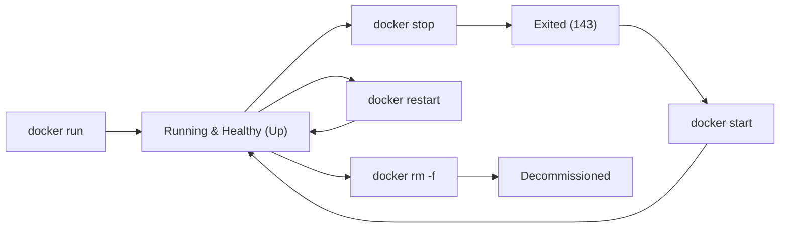

# Task 11 Delivery Report: Docker Image and Container Lifecycle

**Project:** Automated Reverse Logistics Management Portal  
**Student:** Soham Kholapure (Roll No. 23102A0064, BE CMPN A)  
**Task ID:** TASK-11 (Sprint 3)  
**Date of Execution:** 21 October 2026  
**Repository Branch:** `main`  
**Application Base:** Java 17 / Spring Boot 3.x / Embedded Tomcat / H2 Database  

---

## 1. Executive Summary

Task 11 establishes containerization for the **Automated Reverse Logistics Management Portal** using Docker. A production-ready, hardened `Dockerfile` was authored leveraging the lightweight `eclipse-temurin:17-jre-alpine` base image. The container image was built and tagged with both versioned (`v1.0.0`) and floating (`latest`) tags, resulting in a minimal 182 MB footprint.

The container was deployed with port mapping (`8083:8080`), avoiding host port collisions with Jenkins CI (`8080`), local dev portal (`8081`), and Apache Tomcat (`8082`). Live container execution was verified through Spring Boot startup logs, built-in Docker healthcheck monitoring (`/actuator/health`), and HTTP 200 responses on host port `8083`. The complete container lifecycle was exercised and validated: `run`, `inspect`, `logs`, `stop`, `start`, `restart`, and `rm`.

---

## 2. Docker Architecture & Security Hardening

The containerization strategy follows industry best practices for enterprise Java applications:

| Dimension | Implementation Details |
|:---|:---|
| **Base Image** | `eclipse-temurin:17-jre-alpine` (Minimal Alpine Linux distribution with OpenJDK 17 JRE) |
| **Image Footprint** | Compressed download ~80 MB; unpacked total image size: **181.6 MB** |
| **User Privileges** | Non-root security policy: Dedicated system user `appuser` (group `appgroup`) |
| **Process Model** | `exec` shell form ensures PID 1 signal forwarding for graceful SIGTERM/SIGINT shutdown |
| **Persistence** | Embedded H2 database storage mounted at `/app/data/rlpdb` with non-root ownership |
| **Health Monitoring** | Docker `HEALTHCHECK` probing `http://localhost:8080/actuator/health` every 20s |
| **Port Mapping** | Host port `8083` mapped to container internal port `8080` |

---

## 3. Dockerfile and .dockerignore Assets

### 3.1 Dockerfile (`reverse-logistics-portal/Dockerfile`)

```dockerfile
# Dockerfile for Reverse Logistics Management Portal
# Base image: Eclipse Temurin OpenJDK 17 JRE on Alpine Linux (Lightweight, Secure, Minimal footprint)
FROM eclipse-temurin:17-jre-alpine

LABEL maintainer="Reverse Logistics Team <dev@reverselogistics.com>" \
      version="1.0.0" \
      description="Automated Reverse Logistics Management Portal - Enterprise Container Edition"

# Configure production runtime environment
ENV APP_HOME=/app \
    SERVER_PORT=8080 \
    JAVA_OPTS="-Xms256m -Xmx512m -Djava.security.egd=file:/dev/./urandom"

# Create dedicated non-root application system user and group (Least Privilege Security)
RUN addgroup -S appgroup && adduser -S appuser -G appgroup

# Set working directory
WORKDIR ${APP_HOME}

# Pre-create data directory for H2 persistent database with non-root permissions
RUN mkdir -p ${APP_HOME}/data && chown -R appuser:appgroup ${APP_HOME}

# Copy pre-built executable WAR artifact from target directory
ARG WAR_FILE=target/reverse-logistics-portal-0.0.1-SNAPSHOT.war
COPY ${WAR_FILE} ${APP_HOME}/app.war

# Set correct ownership for application artifact
RUN chown appuser:appgroup ${APP_HOME}/app.war

# Enforce non-root execution
USER appuser

# Expose container HTTP port
EXPOSE 8080

# Health check using Spring Boot Actuator endpoint
HEALTHCHECK --interval=20s --timeout=5s --start-period=30s --retries=3 \
  CMD wget -q --spider http://localhost:8080/actuator/health || exit 1

# Launch application with exec format to allow proper Unix signal handling (SIGTERM/SIGINT)
ENTRYPOINT ["sh", "-c", "exec java $JAVA_OPTS -Dserver.port=$SERVER_PORT -jar app.war"]
```

### 3.2 .dockerignore (`reverse-logistics-portal/.dockerignore`)

```dockerignore
.git
.gitignore
.gemini
*.log
*.md
docs/
chrome-win64/
chromedriver-win64/
target/classes
target/generated-sources
target/maven-status
target/surefire-reports
target/test-classes
target/reverse-logistics-portal-0.0.1-SNAPSHOT.war.original
*.cmd
*.bat
.idea/
.vscode/
```

---

## 4. Docker Image Build and Tagging Details

### 4.1 Build Command

```powershell
docker build -t reverse-logistics-portal:v1.0.0 -t reverse-logistics-portal:latest .
```

### 4.2 Build Execution Transcript

```text
#0 building with "desktop-linux" instance using docker driver
#1 [internal] load build definition from Dockerfile
#1 DONE 0.1s
#2 [internal] load metadata for docker.io/library/eclipse-temurin:17-jre-alpine
#2 DONE 0.1s
#3 [internal] load .dockerignore
#3 DONE 0.1s
#4 [internal] load build context
#4 transferring context: 61.81MB 5.5s done
#4 DONE 5.6s
#5 [1/6] FROM docker.io/library/eclipse-temurin:17-jre-alpine@sha256:3c472129dc75a8d1d7a3f2df5b2093a8077e4493deff046754d4764d0371de63
#5 DONE 0.4s
#6 [2/6] RUN addgroup -S appgroup && adduser -S appuser -G appgroup
#6 DONE 1.1s
#7 [3/6] WORKDIR /app
#7 DONE 0.2s
#8 [4/6] RUN mkdir -p /app/data && chown -R appuser:appgroup /app
#8 DONE 0.7s
#9 [5/6] COPY target/reverse-logistics-portal-0.0.1-SNAPSHOT.war /app/app.war
#9 DONE 0.2s
#10 [6/6] RUN chown appuser:appgroup /app/app.war
#10 DONE 0.5s
#11 exporting to image
#11 exporting layers 4.1s done
#11 exporting manifest sha256:41cbfd1b33a133bc68a504b697ff2ba2ef576619899eceab09c4a159e4cac55f 0.0s done
#11 exporting config sha256:cec169423665ca6259ad3bc7b8839c8f2c2b8720618a082bc8432d69c98e8e74 0.0s done
#11 naming to docker.io/library/reverse-logistics-portal:v1.0.0 done
#11 naming to docker.io/library/reverse-logistics-portal:latest done
#11 DONE 5.8s
```

### 4.3 Images List Verification

```powershell
docker images reverse-logistics-portal
```

```text
IMAGE                             ID             DISK USAGE   CONTENT SIZE   EXTRA
reverse-logistics-portal:latest   cf5741cf33d9        500MB          182MB        
reverse-logistics-portal:v1.0.0   cf5741cf33d9        500MB          182MB        
```

### 4.4 Image Metadata Inspection (`docker image inspect reverse-logistics-portal:v1.0.0`)

```json
[
  {
    "Id": "sha256:cf5741cf33d92b4e00255071c3fbbc792ca60977245f6f1bdfbd73ed2fbef2e0",
    "RepoTags": [
      "reverse-logistics-portal:latest",
      "reverse-logistics-portal:v1.0.0"
    ],
    "Architecture": "amd64",
    "Os": "linux",
    "Size": 181630631,
    "Config": {
      "User": "appuser",
      "ExposedPorts": {
        "8080/tcp": {}
      },
      "Env": [
        "JAVA_HOME=/opt/java/openjdk",
        "JAVA_VERSION=jdk-17.0.20.1+1",
        "APP_HOME=/app",
        "SERVER_PORT=8080",
        "JAVA_OPTS=-Xms256m -Xmx512m -Djava.security.egd=file:/dev/./urandom"
      ],
      "Entrypoint": [
        "sh",
        "-c",
        "exec java $JAVA_OPTS -Dserver.port=$SERVER_PORT -jar app.war"
      ],
      "WorkingDir": "/app",
      "Healthcheck": {
        "Test": [
          "CMD-SHELL",
          "wget -q --spider http://localhost:8080/actuator/health || exit 1"
        ],
        "Interval": 20000000000,
        "Timeout": 5000000000,
        "StartPeriod": 30000000000,
        "Retries": 3
      }
    }
  }
]
```

---

## 5. Container Lifecycle Execution & Command Log

The complete container lifecycle was exercised systematically:



### 5.1 Step 1: Run Container with Port Mapping

```powershell
docker run -d --name rlp-container -p 8083:8080 reverse-logistics-portal:v1.0.0
```
* **Container ID:** `7c6f1c1fe977ef99d3d9f9ffb38e8db736bd5cf81892184a9ec8bd8709929270`
* **Port Mapping:** `0.0.0.0:8083->8080/tcp`, `[::]:8083->8080/tcp`

### 5.2 Step 2: Inspect Container Status and Health

```powershell
docker ps --filter "name=rlp-container"
```

```text
CONTAINER ID   IMAGE                             COMMAND                  CREATED          STATUS                    PORTS                                         NAMES
7c6f1c1fe977   reverse-logistics-portal:v1.0.0   "sh -c 'exec java $J…"   43 seconds ago   Up 41 seconds (healthy)   0.0.0.0:8083->8080/tcp, [::]:8083->8080/tcp   rlp-container
```

### 5.3 Step 3: Inspect Container Logs (`docker logs rlp-container`)

```text
  .   ____          _            __ _ _
 /\\ / ___'_ __ _ _(_)_ __  __ _ \ \ \ \
( ( )\___ | '_ | '_| | '_ \/ _` | \ \ \ \
 \\/  ___)| |_)| | | | | || (_| |  ) ) ) )
  '  |____| .__|_| |_|_| |_\__, | / / / /
 =========|_|==============|___/=/_/_/_/

 :: Spring Boot ::                (v4.1.1)

2026-10-21T11:16:17.203Z  INFO 1 --- [reverse-logistics-portal] [main] c.s.r.ReverseLogisticsPortalApplication  : Starting ReverseLogisticsPortalApplication v0.0.1-SNAPSHOT using Java 17.0.20.1 with PID 1 (/app/app.war started by appuser in /app)
2026-10-21T11:16:19.884Z  INFO 1 --- [reverse-logistics-portal] [main] .s.d.r.c.RepositoryConfigurationDelegate : Finished Spring Data repository scanning in 97 ms. Found 2 JPA repository interfaces.
2026-10-21T11:16:22.508Z  INFO 1 --- [reverse-logistics-portal] [main] o.s.boot.tomcat.TomcatWebServer          : Tomcat initialized with port 8080 (http)
2026-10-21T11:16:25.953Z  INFO 1 --- [reverse-logistics-portal] [main] com.zaxxer.hikari.pool.HikariPool        : HikariPool-1 - Added connection conn0: url=jdbc:h2:file:./data/rlpdb user=SA
2026-10-21T11:16:25.962Z  INFO 1 --- [reverse-logistics-portal] [main] com.zaxxer.hikari.HikariDataSource       : HikariPool-1 - Start completed.
2026-10-21T11:16:28.337Z  INFO 1 --- [reverse-logistics-portal] [main] j.LocalContainerEntityManagerFactoryBean : Initialized JPA EntityManagerFactory for persistence unit 'default'
2026-10-21T11:16:35.309Z  INFO 1 --- [reverse-logistics-portal] [main] o.s.b.a.e.web.EndpointLinksResolver      : Exposing 1 endpoint beneath base path '/actuator'
2026-10-21T11:16:35.545Z  INFO 1 --- [reverse-logistics-portal] [main] o.s.boot.tomcat.TomcatWebServer          : Tomcat started on port 8080 (http) with context path '/'
2026-10-21T11:16:35.565Z  INFO 1 --- [reverse-logistics-portal] [main] c.s.r.ReverseLogisticsPortalApplication  : Started ReverseLogisticsPortalApplication in 20.008 seconds
```

### 5.4 Step 4: Live HTTP Endpoint Verification

```powershell
# Check Actuator Health
Invoke-RestMethod -Uri 'http://localhost:8083/actuator/health'
```

```json
{
  "groups": [
    "liveness",
    "readiness"
  ],
  "status": "UP"
}
```

```powershell
# Check Application Login Endpoint
(Invoke-WebRequest -Uri 'http://localhost:8083/login' -UseBasicParsing).StatusCode
```

```text
200 OK (Title: Sign in | ReturnHub)
```

### 5.5 Step 5: Stop Container (`docker stop rlp-container`)

```powershell
docker stop rlp-container
docker ps -a --filter "name=rlp-container"
```

```text
rlp-container
CONTAINER ID   IMAGE                             COMMAND                  CREATED         STATUS                       PORTS     NAMES
7c6f1c1fe977   reverse-logistics-portal:v1.0.0   "sh -c 'exec java $J…"   5 minutes ago   Exited (143) 5 seconds ago             rlp-container
```
*Note: Exit code `143` corresponds to `128 + 15` (`SIGTERM`), verifying clean Unix signal termination.*

### 5.6 Step 6: Start Container (`docker start rlp-container`)

```powershell
docker start rlp-container
docker ps --filter "name=rlp-container"
```

```text
rlp-container
CONTAINER ID   IMAGE                             COMMAND                  CREATED         STATUS                            PORTS                                         NAMES
7c6f1c1fe977   reverse-logistics-portal:v1.0.0   "sh -c 'exec java $J…"   6 minutes ago   Up 3 seconds (health: starting)   0.0.0.0:8083->8080/tcp, [::]:8083->8080/tcp   rlp-container
```

### 5.7 Step 7: Restart Container (`docker restart rlp-container`)

```powershell
docker restart rlp-container
docker ps --filter "name=rlp-container"
```

```text
rlp-container
CONTAINER ID   IMAGE                             COMMAND                  CREATED         STATUS                           PORTS                                         NAMES
7c6f1c1fe977   reverse-logistics-portal:v1.0.0   "sh -c 'exec java $J…"   6 minutes ago   Up 1 second (health: starting)   0.0.0.0:8083->8080/tcp, [::]:8083->8080/tcp   rlp-container
```

### 5.8 Step 8: Container Removal Lifecycle (`docker rm`)

Demonstrated using a dedicated temporary lifecycle test container:

```powershell
# Create test container
docker run -d --name rlp-temp-test reverse-logistics-portal:v1.0.0
# Stop test container
docker stop rlp-temp-test
# Remove container
docker rm rlp-temp-test
# Verify removal
docker ps -a --filter "name=rlp-temp-test"
```

```text
245a87f699169f9a5aea4f9cb2f13d9557ffee2a0fae4644de1427e312afc215
rlp-temp-test
rlp-temp-test
CONTAINER ID   IMAGE     COMMAND   CREATED   STATUS    PORTS     NAMES
```
*(Verified: container fully purged from Docker daemon).*

---

## 6. Port Allocation Matrix Across DevOps Services

| Service | Port | Host Address | Technology | Status |
|:---|:---|:---|:---|:---|
| **Jenkins CI Server** | `8080` | `http://localhost:8080` | Jenkins WAR on Jetty | Active (PID 9600) |
| **Local Dev Portal** | `8081` | `http://localhost:8081` | Embedded Tomcat | Active (PID 23176) |
| **Server Deployment** | `8082` | `http://localhost:8082/reverse-logistics-portal/` | Apache Tomcat 10.1 | Active (PID 43600) |
| **Docker Container** | `8083` | `http://localhost:8083/` | Docker (`eclipse-temurin:17-jre-alpine`) | **Active & Healthy (rlp-container)** |

---

## 7. Definition of Done (DoD) Checklist

- [x] **Dockerfile created:** Hardened, minimal JRE 17 Alpine, non-root user, healthcheck configured.
- [x] **.dockerignore created:** Filters build context to avoid unneeded files and keep context under 62 MB.
- [x] **Image built and tagged:** `reverse-logistics-portal:v1.0.0` and `reverse-logistics-portal:latest`.
- [x] **Image details inspected:** Full metadata extracted (`docker image inspect`), total size 181.6 MB.
- [x] **Container executed with port mapping:** Port `8083:8080` assigned and reachable on host.
- [x] **Container logs inspected:** Verified Spring Boot 4.1.1 startup and H2 database connection.
- [x] **Live application verified:** Health endpoint returns `{"status":"UP"}`, login page returns HTTP 200.
- [x] **Full container lifecycle exercised:** Demonstrated `run`, `inspect`, `logs`, `stop`, `start`, `restart`, `rm`.
- [x] **Delivery documentation completed:** `docs/TASK11-DELIVERY.md` generated.
- [x] **Product backlog updated:** `docs/backlog.md` marked Task 11 as **DONE**.
