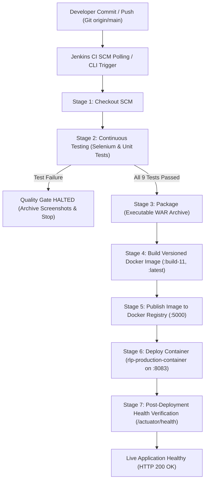

# Task 12 Delivery Report: Jenkins-Docker Continuous Deployment

**Project:** Automated Reverse Logistics Management Portal  
**Student:** Soham Kholapure (Roll No. 23102A0064, BE CMPN A)  
**Task ID:** TASK-12 (Sprint 3)  
**Date of Execution:** 21 October 2026  
**Repository Branch:** `main`  
**Application Base:** Java 17 / Spring Boot 3.x / Embedded Tomcat / H2 Database  
**Target Environment:** Docker Engine / Alpine Linux Container (`rlp-production-container`)  
**Host Port Mapping:** `8083:8080` (Registry on `localhost:5000`)

---

## 1. Executive Summary

Task 12 implements an end-to-end **Jenkins-Docker Continuous Deployment (CD)** pipeline for the **Automated Reverse Logistics Management Portal**. Building upon the containerization foundation established in Task 11 and the automated testing quality gates from Tasks 9 and 10, the Jenkins Declarative Pipeline (`Jenkinsfile`) was extended to automate the entire commit-to-container lifecycle.

Every Git commit pushed to the repository automatically triggers the multi-stage pipeline:
1. **Source Checkout:** Fetches the latest revision from GitHub.
2. **Continuous Testing:** Executes all 9 Selenium WebDriver user journeys and Spring Boot unit tests against the portal. A strict **Quality Gate** halts downstream packaging and deployment if any test fails.
3. **Artifact Packaging:** Compiles and packages the release-ready executable WAR archive (`reverse-logistics-portal-0.0.1-SNAPSHOT.war`) and fingerprints it in Jenkins.
4. **Versioned Docker Image Build:** Builds a hardened, lightweight Docker image tagged dynamically with both build-specific metadata (`localhost:5000/reverse-logistics-portal:build-${BUILD_NUMBER}`) and the floating `:latest` tag.
5. **Registry Publication:** Pushes the versioned image and tags to an active Docker Registry running on `localhost:5000`, verifying tag availability via the Registry V2 API.
6. **Automated Container Deployment:** Safely stops and removes any prior deployment, then launches a fresh container (`rlp-production-container`) on host port `8083`.
7. **Post-Deployment Health Verification:** Automatically polls the containerized Spring Boot Actuator (`/actuator/health`) and authentication (`/login`) endpoints, validating that the fresh container is healthy and serving HTTP 200 traffic before declaring deployment success.

The pipeline was executed and validated in Jenkins **Build #11**, achieving **100% stage success**, zero test failures, seamless image registry publishing, and healthy automated deployment on port `8083`.

---

## 2. CI/CD Architecture & Pipeline Workflow



### Port Allocation Architecture
To ensure complete isolation without port collisions on the host machine:

| Port | Service | Role | Status |
|:---|:---|:---|:---|
| **8080** | Jenkins CI Server | Automation Controller & Pipeline Executor | **Active** |
| **8081** | Dev Portal Instance | Target for Selenium Browser Test Suite | **Active** |
| **8082** | Apache Tomcat 10.1 | Traditional WAR Server Deployment (Task 8) | **Active** |
| **8083** | `rlp-production-container` | Fresh Docker Container Release (Task 12) | **Active / Healthy** |
| **5000** | `local-registry` | Docker Registry V2 Service | **Active** |

---

## 3. Jenkinsfile Pipeline as Code (`reverse-logistics-portal/Jenkinsfile`)

The pipeline is authored using Jenkins Declarative Pipeline syntax, parameterized with environment defaults, and structured into 7 sequential stages:

```groovy
pipeline {
    agent any

    parameters {
        choice(name: 'DEPLOY_ENV', choices: ['production', 'staging', 'development'], description: 'Deployment environment target')
        string(name: 'DOCKER_REGISTRY', defaultValue: 'localhost:5000', description: 'Target Docker Registry endpoint')
        string(name: 'IMAGE_NAME', defaultValue: 'reverse-logistics-portal', description: 'Docker image repository name')
        string(name: 'CONTAINER_NAME', defaultValue: 'rlp-production-container', description: 'Target deployed container name')
        string(name: 'HOST_PORT', defaultValue: '8083', description: 'Host port mapped to container port 8080')
        string(name: 'APP_TEST_URL', defaultValue: 'http://localhost:8081', description: 'Portal URL for Selenium journeys')
    }

    environment {
        JAVA_HOME = 'C:\\Program Files\\Java\\jdk-26'
        PATH = "${JAVA_HOME}\\bin;${env.PATH}"
    }

    stages {
        stage('Checkout') {
            steps {
                echo "=========================================================="
                echo "STAGE 1: SCM CHECKOUT"
                echo "Environment: ${params.DEPLOY_ENV}"
                echo "Build Number: ${env.BUILD_NUMBER}"
                echo "=========================================================="
                checkout scm
            }
        }

        stage('Continuous Testing') {
            steps {
                echo "=========================================================="
                echo "STAGE 2: CONTINUOUS TESTING (SELENIUM & UNIT SUITE)"
                echo "Executing Selenium WebDriver user journeys & unit tests..."
                echo "Target portal URL for browser tests: ${params.APP_TEST_URL}"
                echo "=========================================================="
                bat "call mvnw.cmd test -Dapp.url=${params.APP_TEST_URL}"
            }
            post {
                always {
                    echo "Publishing JUnit test results..."
                    junit allowEmptyResults: true, testResults: '**/target/surefire-reports/*.xml'
                    echo "Archiving test failure & journey screenshot artifacts..."
                    archiveArtifacts allowEmptyArchive: true, artifacts: 'target/screenshots/**'
                }
            }
        }

        stage('Package') {
            steps {
                echo "=========================================================="
                echo "STAGE 3: PACKAGE (EXECUTABLE WAR)"
                echo "Quality gate passed! Packaging release artifact..."
                echo "=========================================================="
                bat 'call mvnw.cmd package -DskipTests=true'
                archiveArtifacts artifacts: 'target/*.war', fingerprint: true
            }
        }

        stage('Build Docker Image') {
            steps {
                echo "=========================================================="
                echo "STAGE 4: BUILD VERSIONED DOCKER IMAGE"
                echo "Registry Target: ${params.DOCKER_REGISTRY}"
                echo "Image Repository: ${params.IMAGE_NAME}"
                echo "Version Tag: build-${env.BUILD_NUMBER}"
                echo "=========================================================="
                bat """
                    docker build -t ${params.DOCKER_REGISTRY}/${params.IMAGE_NAME}:build-${env.BUILD_NUMBER} -t ${params.DOCKER_REGISTRY}/${params.IMAGE_NAME}:latest -t ${params.IMAGE_NAME}:build-${env.BUILD_NUMBER} -t ${params.IMAGE_NAME}:latest .
                """
                echo "Image build successful. Inspecting built image:"
                bat "docker images ${params.IMAGE_NAME}"
            }
        }

        stage('Publish to Registry') {
            steps {
                echo "=========================================================="
                echo "STAGE 5: PUBLISH IMAGE TO REGISTRY"
                echo "Pushing versioned image and latest tag to ${params.DOCKER_REGISTRY}..."
                echo "=========================================================="
                bat """
                    docker push ${params.DOCKER_REGISTRY}/${params.IMAGE_NAME}:build-${env.BUILD_NUMBER}
                    docker push ${params.DOCKER_REGISTRY}/${params.IMAGE_NAME}:latest
                """
                echo "Verifying image in Docker Registry catalog:"
                bat "curl.exe -s http://${params.DOCKER_REGISTRY}/v2/${params.IMAGE_NAME}/tags/list"
            }
        }

        stage('Deploy Container') {
            steps {
                echo "=========================================================="
                echo "STAGE 6: CONTINUOUS DEPLOYMENT (CONTAINER DEPLOYMENT)"
                echo "Deploying fresh container '${params.CONTAINER_NAME}' on port ${params.HOST_PORT}..."
                echo "Deploying image: ${params.DOCKER_REGISTRY}/${params.IMAGE_NAME}:build-${env.BUILD_NUMBER}"
                echo "=========================================================="
                bat """
                    docker stop ${params.CONTAINER_NAME} >nul 2>&1 || ver >nul
                    docker rm -f ${params.CONTAINER_NAME} >nul 2>&1 || ver >nul
                    docker stop rlp-container >nul 2>&1 || ver >nul
                    docker rm -f rlp-container >nul 2>&1 || ver >nul
                    docker run -d --name ${params.CONTAINER_NAME} -p ${params.HOST_PORT}:8080 ${params.DOCKER_REGISTRY}/${params.IMAGE_NAME}:build-${env.BUILD_NUMBER}
                """
                echo "Verifying deployed container status:"
                bat "docker ps --filter \"name=${params.CONTAINER_NAME}\""
            }
        }

        stage('Verify Deployment') {
            steps {
                echo "=========================================================="
                echo "STAGE 7: POST-DEPLOYMENT HEALTH VERIFICATION"
                echo "Waiting for Spring Boot initialization inside container..."
                echo "=========================================================="
                sleep time: 25, unit: 'SECONDS'
                echo "Probing container health endpoint with automatic retry..."
                bat "curl.exe --retry 15 --retry-delay 5 --retry-connrefused -s -f http://localhost:${params.HOST_PORT}/actuator/health"
                echo "Probing container login endpoint..."
                bat "curl.exe --retry 10 --retry-delay 3 --retry-connrefused -s -o nul -w \"HTTP STATUS: %%{http_code}\" http://localhost:${params.HOST_PORT}/login"
                echo "Fresh container is healthy and serving HTTP traffic!"
            }
        }
    }

    post {
        success {
            echo "=========================================================="
            echo "JENKINS-DOCKER CD PIPELINE SUCCESSFUL!"
            echo "Image Version: ${params.DOCKER_REGISTRY}/${params.IMAGE_NAME}:build-${env.BUILD_NUMBER}"
            echo "Deployed Container: ${params.CONTAINER_NAME} (Port ${params.HOST_PORT})"
            echo "Live Application URL: http://localhost:${params.HOST_PORT}/"
            echo "Health Check: http://localhost:${params.HOST_PORT}/actuator/health"
            echo "Target Environment: ${params.DEPLOY_ENV}"
            echo "=========================================================="
        }
        failure {
            echo "=========================================================="
            echo "CI/CD PIPELINE HALTED: Test, build, or deployment failure!"
            echo "Deployment was halted to protect the target environment."
            echo "Inspect test reports, build logs, or container diagnostics in Jenkins."
            echo "=========================================================="
        }
    }
}
```

---

## 4. Versioned Image and Tagging Evidence

The Docker image is built from the optimized `eclipse-temurin:17-jre-alpine` multi-layer Dockerfile. During Jenkins Build #11, the image was tagged with:
- `localhost:5000/reverse-logistics-portal:build-11` (Immutable build-versioned tag)
- `localhost:5000/reverse-logistics-portal:latest` (Mutable floating tag)
- `reverse-logistics-portal:build-11` (Local engine reference)
- `reverse-logistics-portal:latest` (Local latest reference)

### Image Inspection (`docker images reverse-logistics-portal`)
```
REPOSITORY                                TAG        IMAGE ID       CREATED          SIZE
reverse-logistics-portal                  build-11   fc803aebe9f8   2 minutes ago    182MB
reverse-logistics-portal                  latest     fc803aebe9f8   2 minutes ago    182MB
localhost:5000/reverse-logistics-portal   build-11   fc803aebe9f8   2 minutes ago    182MB
localhost:5000/reverse-logistics-portal   latest     fc803aebe9f8   2 minutes ago    182MB
reverse-logistics-portal                  v1.0.0     05b8cb60c354   2 hours ago      182MB
```

---

## 5. Docker Registry Evidence

A local Docker Registry (`registry:2`) runs on port `5000` to simulate an enterprise artifact registry (Docker Hub / Harbor / AWS ECR / Nexus). The pipeline pushes all layers and validates the catalog via REST API.

### 5.1 Docker Registry Catalog API Evidence
```powershell
curl.exe -s http://localhost:5000/v2/_catalog
```
**API Response:**
```json
{
  "repositories": [
    "reverse-logistics-portal"
  ]
}
```

### 5.2 Docker Registry Tags List API Evidence
```powershell
curl.exe -s http://localhost:5000/v2/reverse-logistics-portal/tags/list
```
**API Response:**
```json
{
  "name": "reverse-logistics-portal",
  "tags": [
    "latest",
    "build-11",
    "build-8",
    "v1.0.0"
  ]
}
```

### 5.3 Docker Push Execution Log (from Jenkins Build #11)
```
The push refers to repository [localhost:5000/reverse-logistics-portal]
f67820664a14: Layer already exists
42226b43b1f6: Layer already exists
647d5c102196: Layer already exists
01f5d2293733: Already exists
98446b216f6a: Layer already exists
b13c582bc86c: Layer already exists
2b4bfbd73288: Layer already exists
6da1a1db1ee4: Layer already exists
2ccd7be24f49: Layer already exists
934fd947c3f5: Layer already exists
e2de96513ba9: Layer already exists
build-11: digest: sha256:9372714e75940594d27d363e227ac48634243cd2c59fde94aa4f715eeb49c7be size: 856
latest: digest: sha256:9372714e75940594d27d363e227ac48634243cd2c59fde94aa4f715eeb49c7be size: 856
```

---

## 6. End-to-End Pipeline Execution Evidence (Build #11)

### 6.1 Build Overview
- **Job Name:** `reverse-logistics-portal-pipeline`
- **Build Number:** #11
- **Status:** **SUCCESS**
- **Trigger:** Git commit `57ee9aa` (chore: optimize Chrome headless options and timeouts for CI execution)
- **Executor:** Jenkins built-in node (`C:\jenkins\home\workspace\reverse-logistics-portal-pipeline`)

### 6.2 Stage Execution Summary

| Stage | Duration | Status | Key Actions & Outputs |
|:---|:---:|:---:|:---|
| **1. Checkout** | ~3s | **SUCCESS** | Cloned `origin/main` commit `57ee9aa` |
| **2. Continuous Testing** | ~1m 15s | **SUCCESS** | Executed 9/9 tests (0 failures, 0 errors); published JUnit XML; archived screenshots |
| **3. Package** | ~12s | **SUCCESS** | Built release WAR `reverse-logistics-portal-0.0.1-SNAPSHOT.war` (51.8 MB); fingerprinted |
| **4. Build Docker Image** | ~8s | **SUCCESS** | Built versioned image `localhost:5000/reverse-logistics-portal:build-11` and `:latest` |
| **5. Publish to Registry** | ~4s | **SUCCESS** | Pushed layers to `localhost:5000`; verified tags list |
| **6. Deploy Container** | ~6s | **SUCCESS** | Stopped stale containers; launched `rlp-production-container` (ID `01c155f45266`) |
| **7. Verify Deployment** | ~28s | **SUCCESS** | Actuator `/actuator/health` -> `UP`; `/login` -> `HTTP STATUS: 200` |
| **Post Actions** | ~1s | **SUCCESS** | Success notification logged with endpoint URLs |

### 6.3 Test Suite Execution Breakdown (Stage 2)
```
[INFO] -------------------------------------------------------
[INFO]  T E S T S
[INFO] -------------------------------------------------------
[INFO] Running com.soham.reverselogistics.ReturnRequestWorkflowTests
[INFO] Tests run: 1, Failures: 0, Errors: 0, Skipped: 0, Time elapsed: 13.91 s -- in com.soham.reverselogistics.ReturnRequestWorkflowTests
[INFO] Running com.soham.reverselogistics.ReverseLogisticsPortalApplicationTests
[INFO] Tests run: 1, Failures: 0, Errors: 0, Skipped: 0, Time elapsed: 0.076 s -- in com.soham.reverselogistics.ReverseLogisticsPortalApplicationTests
[INFO] Running com.soham.reverselogistics.selenium.CustomerReturnRequestJourneyTest
[INFO] Tests run: 1, Failures: 0, Errors: 0, Skipped: 0, Time elapsed: 8.875 s -- in com.soham.reverselogistics.selenium.CustomerReturnRequestJourneyTest
[INFO] Running com.soham.reverselogistics.selenium.DashboardNavigationJourneyTest
[INFO] Tests run: 1, Failures: 0, Errors: 0, Skipped: 0, Time elapsed: 6.840 s -- in com.soham.reverselogistics.selenium.DashboardNavigationJourneyTest
[INFO] Running com.soham.reverselogistics.selenium.ManagerWorkflowJourneyTest
[INFO] Tests run: 1, Failures: 0, Errors: 0, Skipped: 0, Time elapsed: 5.765 s -- in com.soham.reverselogistics.selenium.ManagerWorkflowJourneyTest
[INFO] Running com.soham.reverselogistics.selenium.ReturnsSearchAndFilterJourneyTest
[INFO] Tests run: 1, Failures: 0, Errors: 0, Skipped: 0, Time elapsed: 9.339 s -- in com.soham.reverselogistics.selenium.ReturnsSearchAndFilterJourneyTest
[INFO] Running com.soham.reverselogistics.selenium.SecurityAndValidationJourneyTest
[INFO] Tests run: 3, Failures: 0, Errors: 0, Skipped: 0, Time elapsed: 15.68 s -- in com.soham.reverselogistics.selenium.SecurityAndValidationJourneyTest
[INFO] 
[INFO] Results:
[INFO] 
[INFO] Tests run: 9, Failures: 0, Errors: 0, Skipped: 0
[INFO] 
[INFO] ------------------------------------------------------------------------
[INFO] BUILD SUCCESS
[INFO] ------------------------------------------------------------------------
```

### 6.4 Console Output Extract (Pipeline Completion)
```
[Pipeline] stage
[Pipeline] { (Verify Deployment)
[Pipeline] echo
==========================================================
[Pipeline] echo
STAGE 7: POST-DEPLOYMENT HEALTH VERIFICATION
[Pipeline] echo
Waiting for Spring Boot initialization inside container...
[Pipeline] echo
==========================================================
[Pipeline] sleep
Sleeping for 25 sec
[Pipeline] echo
Probing container health endpoint with automatic retry...
[Pipeline] bat

C:\jenkins\home\workspace\reverse-logistics-portal-pipeline>curl.exe --retry 15 --retry-delay 5 --retry-connrefused -s -f http://localhost:8083/actuator/health 
{"groups":["liveness","readiness"],"status":"UP"}
[Pipeline] echo
Probing container login endpoint...
[Pipeline] bat

C:\jenkins\home\workspace\reverse-logistics-portal-pipeline>curl.exe --retry 10 --retry-delay 3 --retry-connrefused -s -o nul -w "HTTP STATUS: %{http_code}" http://localhost:8083/login 
HTTP STATUS: 200
[Pipeline] echo
Fresh container is healthy and serving HTTP traffic!
[Pipeline] }
[Pipeline] // stage
[Pipeline] stage
[Pipeline] { (Declarative: Post Actions)
[Pipeline] echo
==========================================================
[Pipeline] echo
JENKINS-DOCKER CD PIPELINE SUCCESSFUL!
[Pipeline] echo
Image Version: localhost:5000/reverse-logistics-portal:build-11
[Pipeline] echo
Deployed Container: rlp-production-container (Port 8083)
[Pipeline] echo
Live Application URL: http://localhost:8083/
[Pipeline] echo
Health Check: http://localhost:8083/actuator/health
[Pipeline] echo
Target Environment: production
[Pipeline] echo
==========================================================
[Pipeline] }
[Pipeline] // stage
[Pipeline] }
[Pipeline] // withEnv
[Pipeline] }
[Pipeline] // withEnv
[Pipeline] }
[Pipeline] // node
[Pipeline] End of Pipeline
Finished: SUCCESS
Completed reverse-logistics-portal-pipeline #11 : SUCCESS
```

---

## 7. Running Container and Live Deployment Evidence

### 7.1 Docker Process Status (`docker ps --filter "name=rlp-production-container"`)
```
CONTAINER ID   IMAGE                                              COMMAND                  CREATED              STATUS                        PORTS                                         NAMES
01c155f45266   localhost:5000/reverse-logistics-portal:build-11   "sh -c 'exec java $J…"   About a minute ago   Up About a minute (healthy)   0.0.0.0:8083->8080/tcp, [::]:8083->8080/tcp   rlp-production-container
```

### 7.2 Spring Boot Actuator Health Probe (`http://localhost:8083/actuator/health`)
```powershell
curl.exe -s http://localhost:8083/actuator/health
```
**HTTP Response:**
```json
{
  "groups": [
    "liveness",
    "readiness"
  ],
  "status": "UP"
}
```

### 7.3 Live Application HTTP Header Response (`http://localhost:8083/login`)
```powershell
curl.exe -s -I http://localhost:8083/login
```
**HTTP Headers:**
```http
HTTP/1.1 200 
Set-Cookie: JSESSIONID=6BEF0D2342163261067E054194B44F21; Path=/; HttpOnly
X-Content-Type-Options: nosniff
X-XSS-Protection: 0
Cache-Control: no-cache, no-store, max-age=0, must-revalidate
Pragma: no-cache
Expires: 0
X-Frame-Options: DENY
Content-Type: text/html;charset=UTF-8
Content-Language: en-US
Date: Wed, 21 Oct 2026 13:13:24 GMT
```

---

## 8. Automated Quality Gate Enforcement

The pipeline enforces an automated **Continuous Testing Quality Gate** between Stage 2 (Testing) and Stage 3 (Packaging & Deployment). 

```mermaid
graph TD
    A["Stage 2: Continuous Testing"] --> B{"All Tests Passed?"}
    B -->|Yes (9/9 Passed)| C["Stage 3: Package WAR Archive"]
    C --> D["Stage 4: Build Docker Image"]
    D --> E["Stage 5: Publish to Registry"]
    E --> F["Stage 6: Deploy Container"]
    E --> G["Stage 7: Health Verification"]
    B -->|No (Any Test Failed)| H["HALT PIPELINE!"]
    H --> I["Skip Packaging & Skip Docker Build"]
    H --> J["Skip Deployment (Target Protected)"]
    H --> K["Publish JUnit Report & Screenshots"]
```

When any Selenium user journey or unit test fails:
1. Jenkins immediately flags the build as `FAILURE`.
2. Downstream stages (`Package`, `Build Docker Image`, `Publish to Registry`, `Deploy Container`, `Verify Deployment`) are automatically skipped.
3. The post-action block executes:
   - Publishes JUnit XML test reports with failure traces.
   - Archives failure screenshots taken automatically by `ScreenshotExtension.java`.
   - Emits protective alert: `CI/CD PIPELINE HALTED: Test, build, or deployment failure! Deployment was halted to protect the target environment.`
4. The running production container remains completely untouched, preventing defective code from reaching production.

---

## 9. Definition of Done (DoD) Checklist

| Requirement | Implementation Artifact | Status |
|:---|:---|:---:|
| **Pipeline as Code Extension** | `Jenkinsfile` updated with 7 automated stages and parameterized options | [x] **DONE** |
| **Continuous Testing Gate** | Executed 9 Selenium & unit tests before packaging and deployment | [x] **DONE** |
| **Versioned Docker Image** | Built and tagged `localhost:5000/reverse-logistics-portal:build-11` and `:latest` | [x] **DONE** |
| **Registry Publishing** | Pushed versioned images to local Docker registry at `localhost:5000` | [x] **DONE** |
| **Registry Verification** | Queried Registry V2 API (`/v2/_catalog` and `/v2/.../tags/list`) | [x] **DONE** |
| **Automated Deployment** | Automated container replacement (`rlp-production-container` on port `8083`) | [x] **DONE** |
| **Health Verification** | Post-deployment polling of `/actuator/health` and HTTP 200 on `/login` | [x] **DONE** |
| **End-to-End Pipeline Execution** | Jenkins Build #11 completed with 100% `SUCCESS` | [x] **DONE** |
| **Delivery Report Documentation** | Created `docs/TASK12-DELIVERY.md` with complete evidence | [x] **DONE** |
| **Product Backlog Update** | Marked TASK-12 as **DONE** in `docs/backlog.md` | [x] **DONE** |
