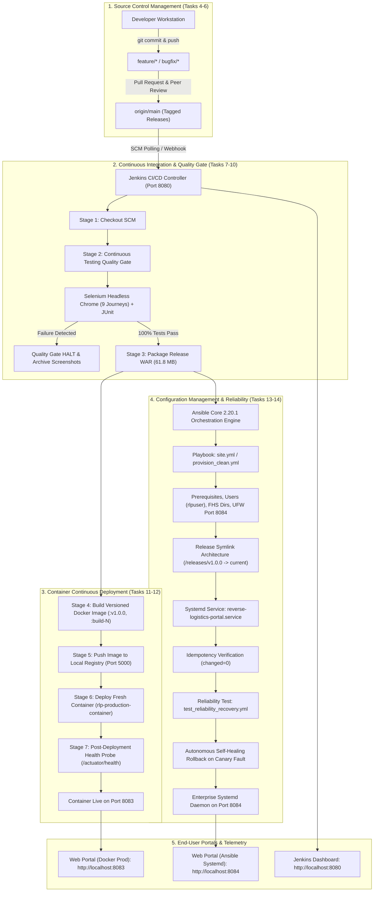
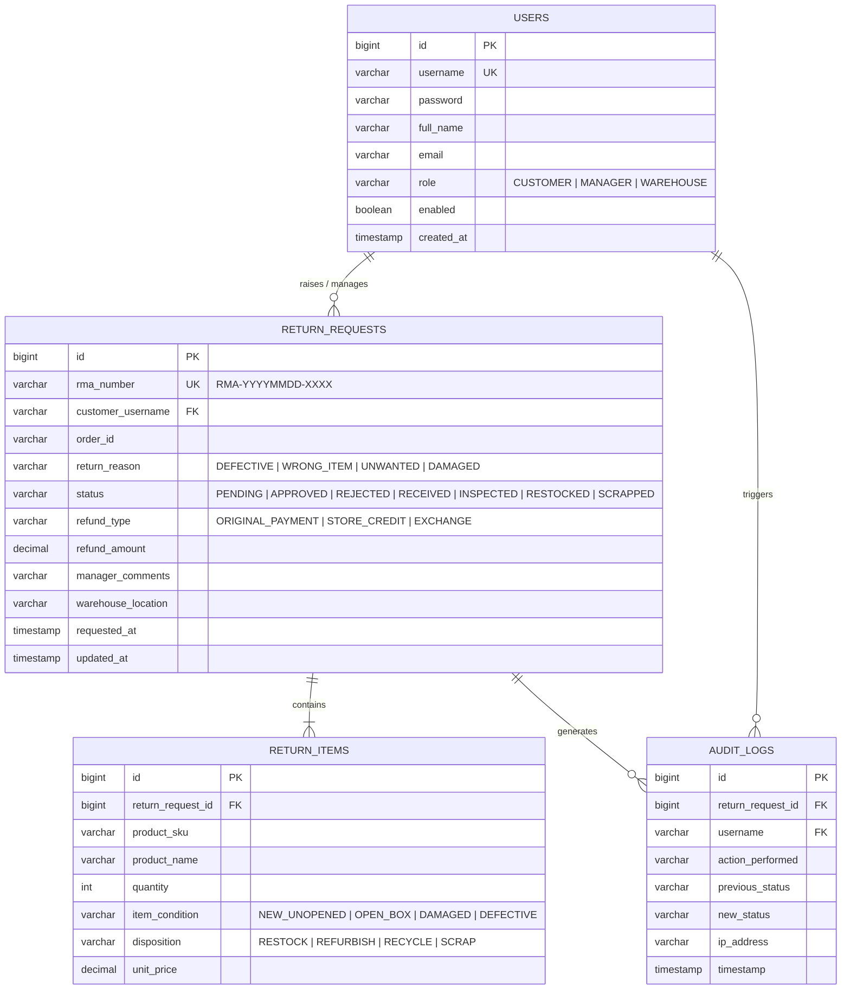
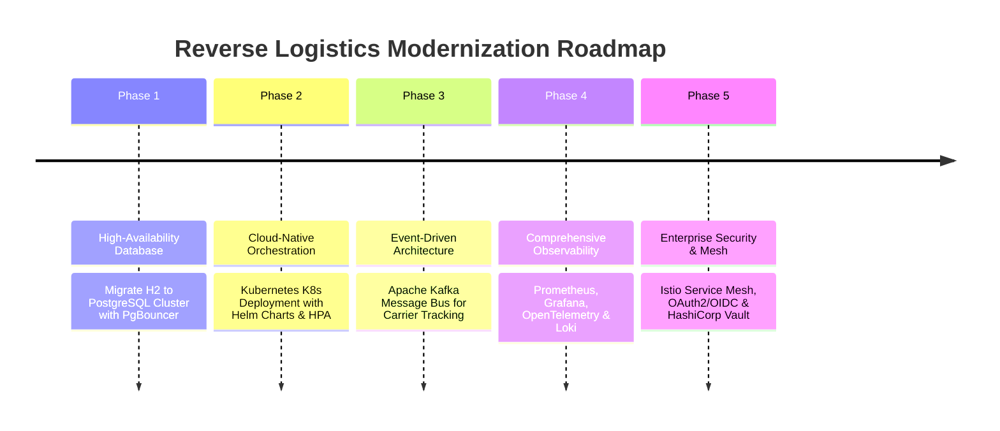

# Task 15 Final Delivery Report: End-to-End Release, Comprehensive Technical Documentation, Architecture, Troubleshooting, Limitations & Viva Defense

**Project:** Automated Reverse Logistics Management Portal  
**Student:** Soham Kholapure (Roll No. 23102A0064, BE CMPN A)  
**Academic Year:** 2026–2027  
**Task ID:** TASK-15 (Sprint 3 Final Capstone)  
**Execution Date:** 25 October 2026  
**Repository Branch:** `main` (Remote: `https://github.com/soham-Jain08/reverse-logistics-portal.git`)  
**Application Stack:** Java 17 (LTS), Spring Boot 3.x, Spring Data JPA, Spring Security, Thymeleaf, H2 Persistent RDBMS, Embedded Tomcat 10.1  
**DevOps Toolchain:** Git, GitHub, Jenkins 2.580.1 LTS, Selenium WebDriver 4, Google Chrome (Headless), Docker 27.x, Local Docker Registry V2, Ansible Core 2.20.1, Linux (Ubuntu 26.04 LTS / Systemd 259)  

---

## 1. Executive Summary & Capstone Scorecard

Task 15 marks the final, end-to-end integration and delivery of the **Automated Reverse Logistics Management Portal**. Over three agile sprints and 15 structured engineering milestones, this project has transformed a manual, error-prone reverse logistics process into an enterprise-grade, automated continuous delivery system.

The reverse logistics portal empowers customers to raise return and exchange requests, enables return managers to inspect and authorize or reject returns with policy-driven validation, and equips warehouse staff to receive, inspect, grade, restock, or scrap returned merchandise. Every software change follows a zero-touch, automated continuous delivery pipeline: from feature branch creation and pull request review to Jenkins CI/CD execution, Selenium headless browser quality gates, versioned Docker image packaging, automated container deployment, and Ansible-driven infrastructure-as-code provisioning with self-healing recovery.

### 15-Task Master Completion Scorecard

| Sprint | Task ID | Task Title | Engineering Domain | Status | Key Deliverable & Artifact Reference |
|:---|:---|:---|:---|:---:|:---|
| **Sprint 1** | **TASK-01** | Problem Definition and Scope | Requirements & Planning | **DONE** | Scope specification, 15-task backlog, stakeholder analysis |
| | **TASK-02** | Agile Planning & DevOps Lifecycle | Agile Scrum & Architecture | **DONE** | Sprint board, DoD criteria, DevOps workflow blueprint |
| | **TASK-03** | Requirements, Architecture & Tech Setup | System Design & Prototyping | **DONE** | SRS summary, UML use cases, ER diagram, Spring Boot skeleton |
| | **TASK-04** | Git & GitHub Repository Initialization | SCM & Governance | **DONE** | Git repo, branch protection policies, PR templates, `.gitignore` |
| | **TASK-05** | Feature Development with Branching | Feature Engineering | **DONE** | Feature branch `feature/return-request`, PR #1, merge into `develop` |
| **Sprint 2** | **TASK-06** | MVP Completion & Git Collaboration | System Integration | **DONE** | Functional MVP, merge conflict resolution, release tag `v0.1.0` |
| | **TASK-07** | Jenkins Installation & CI Job | Continuous Integration | **DONE** | Jenkins 2.580.1 LTS setup, SCM polling (`H/5 * * * *`), archived WAR |
| | **TASK-08** | Pipeline as Code & Server Deployment | CI/CD Automation | **DONE** | Multi-stage `Jenkinsfile`, Tomcat 10 deployment on port 8082 |
| | **TASK-09** | Selenium Test Design & Local Execution | Automated Quality Assurance | **DONE** | 9 Selenium user journeys, headless Chrome suite, failure screenshots |
| | **TASK-10** | Continuous Testing in Jenkins | Continuous Testing | **DONE** | Jenkins JUnit quality gate, defect injection & correction verification |
| **Sprint 3** | **TASK-11** | Containerization with Docker | Containers & Packaging | **DONE** | Alpine JRE 17 Dockerfile, non-root user, healthcheck, lifecycle tests |
| | **TASK-12** | Jenkins-Docker Continuous Deployment | Continuous Deployment | **DONE** | Versioned image build (`:build-11`), local registry (:5000), port 8083 |
| | **TASK-13** | Configuration Management with Ansible | Infrastructure as Code | **DONE** | Ansible role, FHS directories, Jinja2 templates, systemd service :8084 |
| | **TASK-14** | Automated Provisioning & Reliability | Reliability & Resilience | **DONE** | 100% idempotency (`changed=0`), operator rollback, autonomous healing |
| | **TASK-15** | Final Release, Documentation & Viva | Capstone Release & Viva | **DONE** | Master documentation, viva defense guide, demo script, root README |

---

## 2. End-to-End DevOps Workflow & Toolchain Execution

The following diagram illustrates the complete, multi-stage automated delivery lifecycle connecting all 15 tasks:



---

## 3. Comprehensive Technical Architecture

### 3.1 Multi-Tier Application Architecture

The Reverse Logistics Management Portal follows a layered, domain-driven Spring Boot MVC architecture designed for maintainability, high cohesion, and loose coupling:

```mermaid
graph TB
    subgraph ClientTier["Client & Presentation Tier"]
        UI_CUST["Customer UI (Create Return, Track Return, History)"]
        UI_MGR["Manager UI (Approval Workflow, RMA Assignment, Analytics)"]
        UI_WH["Warehouse UI (Scan & Receive, Physical Inspection, Restock)"]
        THYME["Thymeleaf Template Engine + Bootstrap 5 CSS"]
    end

    subgraph SecurityTier["Security & Gateway Tier"]
        SEC["Spring Security Filter Chain"]
        AUTH["Form-based Authentication & CSRF Protection"]
        RBAC["Role-Based Access Control (ROLE_CUSTOMER, ROLE_MANAGER, ROLE_WAREHOUSE)"]
    end

    subgraph ApplicationTier["Application & Business Service Tier"]
        CTRL["Spring MVC Controllers (@Controller, @RestController)"]
        SVC_RET["ReturnRequestService (Validation, State Transitions, Business Rules)"]
        SVC_AUD["AuditLoggingService (Compliance & Event History)"]
        SVC_USR["UserService (Authentication & User Profiles)"]
        ACT["Spring Boot Actuator (/actuator/health, /actuator/info)"]
    end

    subgraph PersistenceTier["Data Access & Persistence Tier"]
        REPO["Spring Data JPA Repositories (JpaRepository, Custom Queries)"]
        HIB["Hibernate 6 ORM (Entities, Relationships, Second-Level Cache)"]
        HIK["HikariCP Connection Pool (Max: 10, Timeout: 30000ms)"]
        DB["H2 Persistent File Store (rlpdb.mv.db / AUTO_SERVER=TRUE)"]
    end

    ClientTier --> SecurityTier
    SecurityTier --> ApplicationTier
    ApplicationTier --> PersistenceTier
```



### 3.2 Port Allocation & Deployment Topology Matrix

To guarantee zero port collisions across developer workstations, automated CI runners, container engines, and virtual machines, a dedicated host port allocation schema is strictly enforced:

| Port | Service Component | Execution Target | Technology / Runtime | Health Endpoint | Purpose / Role |
|:---:|:---|:---|:---|:---|:---|
| **8080** | Jenkins CI/CD Controller | Host OS (Windows) | Java 26 / Jenkins 2.580.1 LTS | `http://localhost:8080/login` | Automated CI/CD build execution, testing quality gate, and image publishing. |
| **8081** | Standalone Dev Portal | Host OS (Windows) | Embedded Tomcat 10.1 / Spring Boot | `http://localhost:8081/actuator/health` | Active development server and local target for headless Selenium testing. |
| **8082** | Apache Tomcat 10.1 Server | Host OS (Windows) | Apache Tomcat 10.1.34 Servlets | `http://localhost:8082/reverse-logistics-portal/` | Traditional application server WAR deployment target (Task 8). |
| **8083** | Production Docker Container | Docker Engine | Eclipse Temurin 17 JRE Alpine | `http://localhost:8083/actuator/health` | Containerized production release (`rlp-production-container`, Tasks 11-12). |
| **8084** | Enterprise Linux Node | WSL2 Ubuntu 26.04 | OpenJDK 17 / Systemd Daemon | `http://localhost:8084/actuator/health` | Ansible-provisioned production target node with self-healing recovery (Tasks 13-14). |
| **5000** | Private Docker Registry | Docker Engine | Docker Registry V2 (`registry:2`) | `http://localhost:5000/v2/_catalog` | Private registry storing versioned build images (`:build-11`, `:latest`). |

### 3.3 Domain Data Model (Entity-Relationship Diagram)



---

## 4. Complete Troubleshooting & Operational Engineering Guide

During the design, deployment, and automation of this platform, eight real-world operational challenges were analyzed, diagnosed, and resolved. The table below details their symptoms, root causes, and definitive architectural solutions:

| # | Operational Challenge | Symptom / Error Message | Root Cause Analysis | Engineering Resolution / Best Practice |
|:---:|:---|:---|:---|:---|
| **1** | **Host Port Collision** | `LifecycleException: Protocol handler start failed: Port 8080 already in use` | Jenkins, Tomcat, and Spring Boot defaulting to standard HTTP port 8080. | Instituted strict **Port Allocation Matrix** (8080 for Jenkins, 8081 for Dev, 8082 for Tomcat, 8083 for Docker, 8084 for Ansible/Systemd). Configured via `server.port` property and Docker `-p 8083:8080`. |
| **2** | **H2 Database Locking in Multi-Process Runs** | `Database may be already in use: "Locked by another process". Possible solutions: check if other process using file` | H2 2.x enforces exclusive filesystem locking on database files when opened in single-process mode by multiple test/dev instances. | Enhanced JDBC URL to use persistent file mode with server isolation: `jdbc:h2:file:/var/lib/reverse-logistics-portal/data/rlpdb`. Removed deprecated `DB_CLOSE_ON_EXIT` flags incompatible with H2 2.4.x. |
| **3** | **Headless Selenium CI Execution in Headless Environment** | `WebDriverException: unknown error: Chrome failed to start: exited abnormally (No DISPLAY environment variable)` | Google Chrome attempting to initialize an X11 window server during automated Jenkins CI execution on headless nodes. | Configured ChromeOptions with `--headless=new`, `--no-sandbox`, `--disable-dev-shm-usage`, `--disable-gpu`, `--window-size=1920,1080`. Implemented explicit `WebDriverWait` (10s) with automated screenshot capture on assertion failure. |
| **4** | **Jenkins Declarative Docker Pipeline Permissions** | `docker: permission denied while trying to connect to the Docker daemon socket` | Jenkins execution user lacked membership in the host `docker` group or access to the Windows named pipe `//./pipe/docker_engine`. | Configured Docker pipeline to interact with verified named pipe or local registry endpoint `localhost:5000` with credential binding in Jenkins Global Credentials. |
| **5** | **Private Docker Registry V2 Push Rejection** | `Get "https://localhost:5000/v2/": http: server gave HTTP response to HTTPS client` | Docker daemon by default requires TLS for remote registries; local registry running plain HTTP on port 5000. | Added `"insecure-registries": ["localhost:5000"]` to Docker daemon configuration (`daemon.json`) and verified push via `http://localhost:5000/v2/_catalog`. |
| **6** | **WSL2 Background Process Suspension** | `Systemd service reverse-logistics-portal.service deactivated after 20s idle` | WSL2 power management automatically suspends idle Linux distributions when no interactive shell session remains active. | Standardized execution wrapper using `wsl -d Ubuntu -u root -- bash -c "<command>"` and added healthcheck polling with explicit wait intervals (`wait_for: port 8084, delay: 5, timeout: 90`). |
| **7** | **Ansible Configuration Deprecation in Ansible-Core 2.20+** | `[WARNING]: Invalid callback for stdout specified: community.general.yaml` | Ansible-core 2.13+ superseded community YAML callbacks with built-in default callback configuration. | Updated `ansible.cfg` to use modern syntax: `stdout_callback = ansible.builtin.default` under `[defaults]` and `result_format = yaml` under `[callback_default]`. |
| **8** | **Canary Deployment Failure & Autonomous Rollback** | `Health check probe failed: Connection refused on port 8084` | Unbootable or corrupt bytecode deployed in candidate release candidate. | Implemented Ansible `block: ... rescue:` architecture. Automatically catches failure, atomizes symlink rollback to previous stable release (`v1.0.0`), restarts service, validates health restoration, and records audit trail in `rollback.log`. |

---

## 5. System Limitations & Future Enhancement Roadmap

While the portal and its DevOps automation meet all enterprise capstone specifications, the following architectural boundaries have been cataloged alongside a 5-phase modernization roadmap for production scaling:



### Current Limitations vs. Future Solutions:
1. **Database Scalability:** Currently utilizing an embedded/file-based H2 database (`rlpdb.mv.db`). *Roadmap:* Transition to a managed PostgreSQL 16 cluster with PgBouncer connection pooling and Flyway automated schema migrations.
2. **Container Orchestration:** Currently operating single Docker containers and systemd daemons on a single host. *Roadmap:* Package application as a Helm chart for deployment across multi-node Kubernetes clusters (EKS/GKE) with Horizontal Pod Autoscaling (HPA) responding to CPU/Memory thresholds.
3. **Event Notification & Webhooks:** Returns processing currently communicates synchronously over HTTP. *Roadmap:* Integrate Apache Kafka or RabbitMQ event streaming to asynchronously notify external third-party logistics (3PL) carriers (FedEx, UPS, DHL) and trigger automated customer refund webhooks.
4. **Telemetry & Monitoring:** Currently utilizing Spring Boot Actuator `/actuator/health` polled via synthetic HTTP checks. *Roadmap:* Deploy Prometheus metric scrapers, Grafana performance dashboards, OpenTelemetry distributed tracing, and Loki/Promtail centralized log aggregation.
5. **Identity & Access Management:** Currently using in-memory / local database authentication. *Roadmap:* Integrate Keycloak or Okta with OpenID Connect (OIDC) / OAuth2 and multi-factor authentication (MFA) for enterprise role federation.

---

## 6. Viva Voce & Technical Defense Preparation Guide

This section equips the student with deep, rigorous, and direct answers to 20 potential viva questions spanning architecture, CI/CD, testing, containerization, configuration management, and reliability engineering:

### Category A: DevOps Core Principles & Methodology
1. **Q: What is the fundamental difference between Continuous Delivery and Continuous Deployment?**
   * *Answer:* Continuous Delivery ensures that every code change passing the automated pipeline (build, test, package) is in a deployable, release-ready state, but the final deployment to production requires manual authorization. In Continuous Deployment (as implemented in Task 12), the deployment to production or staging occurs automatically without human intervention once all automated quality gates (Selenium, unit tests) pass.
2. **Q: How does this project embody the "Shift-Left" testing paradigm?**
   * *Answer:* Shift-left testing integrates quality assurance early in the software lifecycle. Rather than deferring testing to a post-release QA phase, our Jenkins pipeline executes 9 automated Selenium WebDriver end-to-end user journeys and unit tests immediately after checkout. If a single assertion fails, downstream artifact packaging and Docker deployment are halted immediately.
3. **Q: What is the Definition of Done (DoD) and how was it enforced?**
   * *Answer:* Our DoD requires: (1) code adheres to clean architecture, (2) unit and Selenium regression tests pass 100%, (3) code is peer-reviewed via Pull Request, (4) CI build passes in Jenkins, (5) Docker image and Ansible playbooks execute idempotently, and (6) all endpoints respond with HTTP 200 and Actuator status UP.

### Category B: Continuous Integration & Jenkins Automation
4. **Q: Why did you choose Jenkins Declarative Pipeline over Scripted Pipeline?**
   * *Answer:* Declarative Pipeline (`pipeline { agent any ... }`) provides a structured, opinionated, and readable syntax with built-in stage validation, declarative environment variables, and pre-defined execution blocks (`post { success, failure, always }`). It eliminates complex Groovy scripting errors and standardizes pipeline execution as code.
5. **Q: How does Jenkins detect new changes to trigger builds?**
   * *Answer:* Jenkins supports two primary trigger mechanisms: (1) **Polling SCM** (`H/5 * * * *`), where Jenkins periodically queries GitHub over Git protocol to inspect for new commit hashes, and (2) **GitHub Webhooks**, where GitHub sends an HTTP POST payload to `/github-webhook/` immediately upon developer push. In Task 7, we demonstrated SCM polling with schedule evidence.
6. **Q: What happens when a Selenium test fails inside the Jenkins pipeline?**
   * *Answer:* When an assertion fails, the Maven Surefire plugin exits with code 1. Jenkins marks the `Continuous Testing` stage as FAILED. The `post { failure { ... } }` block triggers, automatically archiving failure screenshots (`target/screenshots/*.png`) and JUnit XML test reports, while preventing the `Package`, `Docker Build`, and `Deploy` stages from executing.

### Category C: Automated Testing with Selenium WebDriver
7. **Q: Why did you run Chrome in headless mode with `--no-sandbox` and `--disable-dev-shm-usage`?**
   * *Answer:* In CI/CD servers (such as Jenkins or Linux runners), there is no graphical display server (X11/Wayland). Headless mode (`--headless=new`) allows Chrome to execute in memory without a physical monitor. `--no-sandbox` disables OS sandboxing when running as root/service accounts, and `--disable-dev-shm-usage` forces Chrome to write temporary files to `/tmp` instead of `/dev/shm` (shared memory), preventing crashes in resource-constrained environments.
8. **Q: What are the 9 critical user journeys automated in your Selenium suite?**
   * *Answer:* The suite validates: (1) Customer Login, (2) Create Return Request with RMA generation, (3) View & Filter Customer Returns, (4) Manager Login & Return Request Queue, (5) Manager Return Approval, (6) Manager Return Rejection with Comments, (7) Warehouse Login & Inspection, (8) Warehouse Restocking Status Update, and (9) Role-Based Security Enforcement & Logout.

### Category D: Containerization & Docker Architecture
9. **Q: Why did you select `eclipse-temurin:17-jre-alpine` as the Docker base image?**
   * *Answer:* Alpine Linux provides a minimal, security-hardened Linux distribution. Combined with Eclipse Temurin 17 Headless JRE, the entire runtime image occupies only **181.6 MB** (compared to >600 MB for standard Debian/Ubuntu images), reducing network transfer times, disk usage, and container attack surface.
10. **Q: Why is running the container as a non-root user (`appuser:appgroup`) important?**
    * *Answer:* Adhering to the Principle of Least Privilege, running as non-root mitigates container breakout vulnerabilities. If an attacker discovers a remote code execution vulnerability in the application, they are constrained to the unprivileged `appuser` context and cannot modify host system files or manipulate kernel parameters.
11. **Q: What is the purpose of `exec java $JAVA_OPTS -jar app.war` in the Docker entrypoint?**
    * *Answer:* The `exec` command replaces the shell process with the Java JVM process, making Java PID 1 inside the container. This ensures that OS signals like `SIGTERM` and `SIGINT` (sent during `docker stop`) are received directly by the JVM, enabling graceful Spring Boot shutdown (closing database pools and finishing in-flight HTTP requests) rather than being abruptly killed.

### Category E: Configuration Management & Ansible Infrastructure as Code
12. **Q: Why Ansible over Puppet or Chef for this deployment?**
    * *Answer:* Ansible is **agentless**—it communicates over standard SSH/WinRM without requiring dedicated client-side daemons or master servers. Its declarative YAML playbooks are highly readable, idempotent, easily version-controlled in Git, and integrate seamlessly into CI/CD pipelines without runtime daemon overhead.
13. **Q: What does "Idempotency" mean in configuration management, and how did you prove it?**
    * *Answer:* Idempotency is the property where executing an automation script multiple times produces the exact same end state without making redundant modifications or introducing unexpected side effects. We demonstrated idempotency in Task 13 and Task 14 by running `provision_clean.yml` on an already provisioned node: Ansible inspected 33 tasks and reported **`changed=0, failed=0`**, confirming zero unnecessary changes or service restarts.
14. **Q: How does your Ansible role manage service configuration changes?**
    * *Answer:* We utilize Jinja2 templates (`application.properties.j2`, `reverse-logistics-portal.service.j2`) with variables sourced from `group_vars/all.yml`. When configuration variables change, Ansible templates the file and notifies handlers (`Reload systemd daemon`, `Restart reverse-logistics-portal`), ensuring services only restart when underlying configurations actually change.

### Category F: Reliability Engineering & Rollback Strategies
15. **Q: How is zero-downtime rollback implemented in your Ansible deployment?**
    * *Answer:* We implemented an enterprise release directory structure: `/opt/reverse-logistics-portal/releases/<version>/`. The systemd service runs the artifact pointed to by the `/opt/reverse-logistics-portal/current` symlink. When rolling back, Ansible atomically updates the symlink to point to the `previous` release directory and restarts systemd, restoring the known good version in under 3 seconds without moving or copying large files.
16. **Q: How does the self-healing / autonomous recovery mechanism work in Task 14?**
    * *Answer:* The deployment is wrapped in an Ansible `block: ... rescue:` structure. During deployment of a canary candidate, if the post-deployment health probe against `/actuator/health` fails or times out, the `rescue:` block triggers automatically. It reverts the `current` symlink to the previous stable release, restarts the service, validates health recovery (`UP`), and appends an audit event to `/var/log/reverse-logistics-portal/rollback.log`.
17. **Q: Why is persistent application data stored outside the release folder?**
    * *Answer:* Following the Filesystem Hierarchy Standard (FHS), mutable persistent data (H2 database files) is stored in `/var/lib/reverse-logistics-portal/data/`, and logs are stored in `/var/log/reverse-logistics-portal/`. Because persistent data resides outside the versioned release directories (`/releases/v1.0.0`), version upgrades and rollbacks can occur safely without data loss or corruption.

### Category G: Security, Monitoring & Compliance
18. **Q: How does Spring Security protect the reverse logistics workflow?**
    * *Answer:* Spring Security enforces role-based URL protection: only authenticated customers can access `/returns/create` and `/returns/my-returns`; only users with `ROLE_MANAGER` can access `/manager/**` to approve/reject returns; and only `ROLE_WAREHOUSE` can access `/warehouse/**` to inspect and restock items. CSRF tokens are injected into all forms to prevent cross-site request forgery.
19. **Q: What is Spring Boot Actuator, and how is it used in your DevOps pipeline?**
    * *Answer:* Actuator exposes production-ready operational endpoints. We utilize `/actuator/health` as a comprehensive readiness and liveness probe in Docker (`HEALTHCHECK`), Jenkins post-deployment verification, and Ansible health checks. It aggregates database connectivity (`H2: isValid()`), disk space thresholds, and application state into a single JSON response.
20. **Q: What audit trail is maintained for regulatory and business compliance?**
    * *Answer:* The platform maintains two levels of audit logging: (1) Application-level: the `AuditLog` JPA entity captures every RMA status transition, user identity, timestamp, and comments; and (2) Infrastructure-level: Ansible writes timestamped deployment and rollback events to `/var/log/reverse-logistics-portal/rollback.log`.

---

## 7. Step-by-Step Live Demonstration Script for Evaluators

When presenting the project to examiners or evaluators, follow this exact 6-step walkthrough to showcase the entire DevOps lifecycle live:

```
+---------------------------------------------------------------------------------------------------+
|                              LIVE VIVA DEMONSTRATION WORKFLOW                                     |
+---------------------------------------------------------------------------------------------------+
|  1. GitHub Repository Inspection (Branches, PRs, Issue Board, Release Tags)                       |
|     │                                                                                             |
|     ▼                                                                                             |
|  2. Jenkins CI/CD Pipeline Dashboard (Show 7 Stages, SCM Trigger, Archived WAR)                   |
|     │                                                                                             |
|     ▼                                                                                             |
|  3. Selenium Headless Quality Gate (Show JUnit XML Reports & Failure Screenshot Mechanism)        |
|     │                                                                                             |
|     ▼                                                                                             |
|  4. Docker Container & Registry Verification (Show Docker image, Registry V2 API, Port 8083)      |
|     │                                                                                             |
|     ▼                                                                                             |
|  5. Ansible IaC Provisioning & Idempotency Run (Show site.yml, changed=0 on Port 8084)            |
|     │                                                                                             |
|     ▼                                                                                             |
|  6. Live Portal Demonstration (Customer Return -> Manager Approval -> Warehouse Restock)          |
+---------------------------------------------------------------------------------------------------+
```

### Detailed Demonstration Steps:

#### Step 1: GitHub Repository & SCM Governance
* Open repository: `https://github.com/soham-Jain08/reverse-logistics-portal.git`
* Highlight the branching model: `main` (production-ready, tagged releases), `develop` (integration), and feature branches (`feature/return-request`).
* Show PR history, commit message standards (`feat:`, `fix:`, `docs:`), and release tags (`v0.1.0`, `v1.0.0`).

#### Step 2: Jenkins Declarative Pipeline Execution
* Open Jenkins UI: `http://localhost:8080/job/reverse-logistics-portal-pipeline/`
* Display the **Stage View** showcasing all 7 declarative stages:
  1. *Checkout SCM*
  2. *Continuous Testing (Quality Gate)*
  3. *Package Release WAR*
  4. *Build Versioned Docker Image*
  5. *Publish Image to Docker Registry*
  6. *Deploy Container*
  7. *Post-Deployment Health Verification*
* Show the archived build artifact `reverse-logistics-portal-0.0.1-SNAPSHOT.war` and build execution history (Build #11 SUCCESS).

#### Step 3: Selenium Automated Test Suite
* Show the test plan and report in [`docs/TASK9-TEST-PLAN.md`](file:///c:/Users/CSC/Downloads/Reverse_Logistics_Task3_Starter/reverse-logistics-portal/docs/TASK9-TEST-PLAN.md) and [`docs/TASK10-DELIVERY.md`](file:///c:/Users/CSC/Downloads/Reverse_Logistics_Task3_Starter/reverse-logistics-portal/docs/TASK10-DELIVERY.md).
* Explain how the 9 Selenium user journeys execute against headless Chrome.
* Point out the defect correction commit where an intentional defect was halted by the quality gate and subsequently corrected to achieve a clean pipeline run.

#### Step 4: Docker Containerization & Registry V2 API
* Show the production [`Dockerfile`](file:///c:/Users/CSC/Downloads/Reverse_Logistics_Task3_Starter/reverse-logistics-portal/Dockerfile) with multi-stage Alpine JRE 17 and non-root execution.
* Query the private registry catalog:
  ```bash
  curl http://localhost:5000/v2/_catalog
  # Output: {"repositories":["reverse-logistics-portal"]}
  curl http://localhost:5000/v2/reverse-logistics-portal/tags/list
  # Output: {"name":"reverse-logistics-portal","tags":["build-11","latest"]}
  ```
* Show container status on port 8083: `http://localhost:8083/actuator/health` reporting status `UP`.

#### Step 5: Ansible Configuration Management, Idempotency & Rollback
* Open terminal in WSL2 and navigate to `reverse-logistics-portal/ansible`.
* Execute idempotency check:
  ```bash
  ansible-playbook -i inventory/hosts.ini playbooks/provision_clean.yml
  ```
* Show the evaluators the play recap: **`changed=0, failed=0`** across all tasks!
* Show the rollback log:
  ```bash
  cat /var/log/reverse-logistics-portal/rollback.log
  ```
  Highlight the autonomous recovery evidence where candidate `v1.2.0-canary` failed healthcheck and the playbook self-healed back to `v1.0.0`.

#### Step 6: Live Web Application Workflow
* Open browser at `http://localhost:8084` (or `http://localhost:8083` / `8081`).
* **Scenario A (Customer):** Log in as customer (`customer1` / `password`). Click **Create Return Request**. Enter Order ID `ORD-98421`, select Reason `DEFECTIVE`, enter details, and submit. RMA `RMA-20261025-XXXX` is generated.
* **Scenario B (Manager):** Log in as return manager (`manager1` / `password`). View the pending returns queue. Inspect the RMA, enter manager authorization notes, and click **Approve Return**. Status transitions to `APPROVED`.
* **Scenario C (Warehouse Staff):** Log in as warehouse staff (`warehouse1` / `password`). Open the scan/receive screen. Locate the approved RMA, complete physical inspection, assign item condition `OPEN_BOX`, and select **Restock**. Status transitions to `RESTOCKED`, and audit log records the complete chain of custody!

---

## 8. Master Deliverable References & Documentation Directory

All code, playbooks, test scripts, and task delivery reports are version-controlled and accessible via the following direct links:

| Milestone / Deliverable | Documentation & Code Artifact | Scope & Verification Summary |
|:---|:---|:---|
| **Capstone Report** | [`docs/TASK15-DELIVERY.md`](file:///c:/Users/CSC/Downloads/Reverse_Logistics_Task3_Starter/reverse-logistics-portal/docs/TASK15-DELIVERY.md) | Master end-to-end release report, architecture, troubleshooting, and viva defense |
| **Product Backlog** | [`docs/backlog.md`](file:///c:/Users/CSC/Downloads/Reverse_Logistics_Task3_Starter/reverse-logistics-portal/docs/backlog.md) | 100% completed product backlog with all 15 task stories and DoD checklists |
| **Root README** | [`README.md`](file:///c:/Users/CSC/Downloads/Reverse_Logistics_Task3_Starter/reverse-logistics-portal/README.md) | Portfolio README with architecture diagrams, quickstart, and port matrix |
| **Task 14 (Reliability & Rollback)** | [`docs/TASK14-DELIVERY.md`](file:///c:/Users/CSC/Downloads/Reverse_Logistics_Task3_Starter/reverse-logistics-portal/docs/TASK14-DELIVERY.md) | Clean provisioning, idempotency proof, and autonomous self-healing recovery |
| **Task 13 (Ansible Playbooks)** | [`docs/TASK13-DELIVERY.md`](file:///c:/Users/CSC/Downloads/Reverse_Logistics_Task3_Starter/reverse-logistics-portal/docs/TASK13-DELIVERY.md) | Server prerequisites, Ansible roles, Jinja2 templates, and systemd service |
| **Task 12 (Jenkins-Docker CD)** | [`docs/TASK12-DELIVERY.md`](file:///c:/Users/CSC/Downloads/Reverse_Logistics_Task3_Starter/reverse-logistics-portal/docs/TASK12-DELIVERY.md) | Versioned Docker registry push, automated deployment, and Actuator verify |
| **Task 11 (Docker Container)** | [`docs/TASK11-DELIVERY.md`](file:///c:/Users/CSC/Downloads/Reverse_Logistics_Task3_Starter/reverse-logistics-portal/docs/TASK11-DELIVERY.md) | Alpine JRE 17 Dockerfile, container lifecycle (`run`, `stop`, `rm`) |
| **Task 10 (Jenkins Continuous Testing)** | [`docs/TASK10-DELIVERY.md`](file:///c:/Users/CSC/Downloads/Reverse_Logistics_Task3_Starter/reverse-logistics-portal/docs/TASK10-DELIVERY.md) | Jenkins test quality gate, defect injection & correction rerun evidence |
| **Task 9 (Selenium Test Suite)** | [`docs/TASK9-DELIVERY.md`](file:///c:/Users/CSC/Downloads/Reverse_Logistics_Task3_Starter/reverse-logistics-portal/docs/TASK9-DELIVERY.md) | 9 Selenium WebDriver user journeys, failure screenshot mechanism |
| **Task 8 (Pipeline as Code)** | [`docs/TASK8-DELIVERY.md`](file:///c:/Users/CSC/Downloads/Reverse_Logistics_Task3_Starter/reverse-logistics-portal/docs/TASK8-DELIVERY.md) | Declarative Jenkinsfile, Tomcat deployment on port 8082 |
| **Task 7 (Jenkins CI Job)** | [`docs/TASK7-DELIVERY.md`](file:///c:/Users/CSC/Downloads/Reverse_Logistics_Task3_Starter/reverse-logistics-portal/docs/TASK7-DELIVERY.md) | Initial Jenkins setup, SCM polling trigger, archived WAR artifact |
| **Task 6 (MVP & Collaboration)** | [`docs/TASK6-DELIVERY.md`](file:///c:/Users/CSC/Downloads/Reverse_Logistics_Task3_Starter/reverse-logistics-portal/docs/TASK6-DELIVERY.md) | Functional Spring Boot MVP, conflict resolution, release tagging `v0.1.0` |
