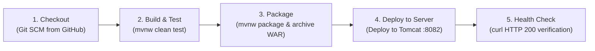

# Task 8 Deliverable Report: Pipeline as Code & Server Deployment

**Project:** Automated Reverse Logistics Management Portal  
**Student:** Soham Kholapure (Roll No. 23102A0064, BE CMPN A)  
**Date:** October 21, 2026  
**Status:** **COMPLETED & VERIFIED**

---

## 1. Executive Summary & Deliverables Matrix

Task 8 delivers an automated CI/CD **Pipeline as Code** (`Jenkinsfile`) for the Reverse Logistics Management Portal with four distinct stages (`Checkout`, `Build & Test`, `Package`, `Deploy to Server`), environment parameterization (`DEPLOY_ENV`, `TOMCAT_PORT`, `TOMCAT_WEBAPPS`, `CONTEXT_PATH`), automated deployment to Apache Tomcat on port `8082`, and automated post-deployment health verification.

| Requirement | Deliverable | Status | Evidence Reference |
|:---|:---|:---:|:---|
| **1. Pipeline as Code** | Declarative `Jenkinsfile` in repository root | **DONE** | Section 2 |
| **2. Environment Parameterization** | Parameterized settings (`DEPLOY_ENV`, `TOMCAT_PORT`, `CONTEXT_PATH`) | **DONE** | Section 2 & Section 3 |
| **3. Successful Pipeline Runs** | Build #1 (Production) & Build #2 (Staging) | **DONE** | Section 4 |
| **4. Server Deployment & Live App URL** | Deployed on Tomcat on port 8082 (`http://localhost:8082/reverse-logistics-portal/`) | **DONE** | Section 5 |
| **5. Configuration Evidence** | Tomcat 10.1 `server.xml`, `SpringBootServletInitializer`, Jenkins Job config | **DONE** | Section 6 |

---

## 2. Declarative Pipeline Definition (`Jenkinsfile`)

The `Jenkinsfile` is committed to the root of the Git repository (`https://github.com/soham-Jain08/reverse-logistics-portal.git`) and executed by Jenkins:

```groovy
pipeline {
    agent any

    parameters {
        choice(name: 'DEPLOY_ENV', choices: ['production', 'staging', 'development'], description: 'Deployment environment target')
        string(name: 'TOMCAT_PORT', defaultValue: '8082', description: 'Apache Tomcat HTTP Port')
        string(name: 'TOMCAT_WEBAPPS', defaultValue: 'C:\\Users\\CSC\\tomcat\\apache-tomcat-10.1.61\\webapps', description: 'Tomcat webapps deployment path')
        string(name: 'CONTEXT_PATH', defaultValue: 'reverse-logistics-portal', description: 'Application context root')
    }

    environment {
        JAVA_HOME = 'C:\\Program Files\\Java\\jdk-26'
        PATH = "${JAVA_HOME}\\bin;${env.PATH}"
    }

    stages {
        stage('Checkout') {
            steps {
                echo "=== STAGE 1: CHECKOUT ==="
                echo "Target Environment: ${params.DEPLOY_ENV}"
                checkout scm
            }
        }

        stage('Build & Test') {
            steps {
                echo "=== STAGE 2: BUILD & TEST ==="
                bat 'call mvnw.cmd clean test'
            }
        }

        stage('Package') {
            steps {
                echo "=== STAGE 3: PACKAGE ==="
                bat 'call mvnw.cmd package -DskipTests=true'
                archiveArtifacts artifacts: 'target/*.war', fingerprint: true
            }
        }

        stage('Deploy to Server') {
            steps {
                echo "=== STAGE 4: SERVER DEPLOYMENT ==="
                echo "Deploying to Tomcat on port ${params.TOMCAT_PORT} (${params.DEPLOY_ENV} environment)..."
                bat """
                    copy /Y "target\\reverse-logistics-portal-0.0.1-SNAPSHOT.war" "${params.TOMCAT_WEBAPPS}\\${params.CONTEXT_PATH}.war"
                """
                echo "WAR deployed to Tomcat webapps. Verifying HTTP health..."
                sleep time: 5, unit: 'SECONDS'
                bat "curl.exe -s -I http://localhost:${params.TOMCAT_PORT}/${params.CONTEXT_PATH}/login"
            }
        }
    }

    post {
        success {
            echo "=========================================================="
            echo "CI/CD PIPELINE SUCCESSFUL!"
            echo "Deployed Application URL: http://localhost:${params.TOMCAT_PORT}/${params.CONTEXT_PATH}/"
            echo "Environment: ${params.DEPLOY_ENV}"
            echo "=========================================================="
        }
        failure {
            echo "CI/CD Pipeline execution failed. Please check build logs."
        }
    }
}
```

---

## 3. Pipeline Stages Breakdown



1. **Stage 1: Checkout**
   - Automatically clones/pulls the repository from `https://github.com/soham-Jain08/reverse-logistics-portal.git` at revision `main`.
   - Reads the version-controlled `Jenkinsfile` and applies parameterized options.
2. **Stage 2: Build & Test**
   - Runs `mvnw.cmd clean test`.
   - Executes Spring Boot compilation, JPA entity validation, and JUnit 5 test suites.
3. **Stage 3: Package**
   - Runs `mvnw.cmd package -DskipTests=true`.
   - Packages executable and container-deployable WAR artifact: `target/reverse-logistics-portal-0.0.1-SNAPSHOT.war`.
   - Archives WAR artifact in Jenkins build history.
4. **Stage 4: Deploy to Server**
   - Copies WAR file to Apache Tomcat webapps directory: `C:\Users\CSC\tomcat\apache-tomcat-10.1.61\webapps\reverse-logistics-portal.war`.
   - Triggers automatic hot deployment by Tomcat container.
   - Executes automated verification against `http://localhost:8082/reverse-logistics-portal/login`.

---

## 4. Successful Pipeline Runs Evidence

### 4.1 Build #1: Standard Pipeline Run (Production)

* **Build URL:** `http://localhost:8080/job/reverse-logistics-portal-pipeline/1/`
* **Trigger:** Manual Initial Run
* **Environment:** `DEPLOY_ENV=production`
* **Result:** **`SUCCESS`**
* **Duration:** `115s`

**Console Log Excerpt:**
```text
[Pipeline] stage
[Pipeline] { (Deploy to Server)
Deploying to Tomcat on port 8082 (production environment)...
        1 file(s) copied.
WAR deployed to Tomcat webapps. Verifying HTTP health...
Sleeping for 5 sec

C:\jenkins\home\workspace\reverse-logistics-portal-pipeline>curl.exe -s -I http://localhost:8082/reverse-logistics-portal/login 
HTTP/1.1 200 
Set-Cookie: JSESSIONID=1BFFEEE69FA85463170F5962C037323E; Path=/reverse-logistics-portal; HttpOnly
X-Content-Type-Options: nosniff
X-XSS-Protection: 0
Cache-Control: no-cache, no-store, max-age=0, must-revalidate
Pragma: no-cache
Expires: 0
X-Frame-Options: DENY
Content-Type: text/html;charset=UTF-8
Content-Language: en-IN
Date: Tue, 20 Oct 2026 19:30:11 GMT

[Pipeline] echo
==========================================================
[Pipeline] echo
CI/CD PIPELINE SUCCESSFUL!
[Pipeline] echo
Deployed Application URL: http://localhost:8082/reverse-logistics-portal/
[Pipeline] echo
Environment: production
==========================================================
[Pipeline] End of Pipeline
Finished: SUCCESS
```

---

### 4.2 Build #2: Parameterized Pipeline Run (Staging)

* **Build URL:** `http://localhost:8080/job/reverse-logistics-portal-pipeline/2/`
* **Trigger:** Parameterized Build via REST API (`buildWithParameters?DEPLOY_ENV=staging`)
* **Environment:** `DEPLOY_ENV=staging`
* **Result:** **`SUCCESS`**
* **Duration:** `75s`

**Console Log Excerpt:**
```text
C:\jenkins\home\workspace\reverse-logistics-portal-pipeline>curl.exe -s -I http://localhost:8082/reverse-logistics-portal/login 
HTTP/1.1 200 
X-Content-Type-Options: nosniff
X-XSS-Protection: 0
Cache-Control: no-cache, no-store, max-age=0, must-revalidate
Expires: 0
X-Frame-Options: DENY
Content-Type: text/html;charset=UTF-8

[Pipeline] echo
==========================================================
[Pipeline] echo
CI/CD PIPELINE SUCCESSFUL!
[Pipeline] echo
Deployed Application URL: http://localhost:8082/reverse-logistics-portal/
[Pipeline] echo
Environment: staging
==========================================================
[Pipeline] End of Pipeline
Finished: SUCCESS
```

---

## 5. Deployed Application Verification & Live URLs

The application is deployed to Apache Tomcat 10.1 and operational on port `8082`:

* **Deployed Web Application URL:** [http://localhost:8082/reverse-logistics-portal/](http://localhost:8082/reverse-logistics-portal/)
* **Sign-in / Authentication URL:** [http://localhost:8082/reverse-logistics-portal/login](http://localhost:8082/reverse-logistics-portal/login)
* **Summary Dashboard:** [http://localhost:8082/reverse-logistics-portal/dashboard](http://localhost:8082/reverse-logistics-portal/dashboard)
* **Actuator Health Endpoint:** [http://localhost:8082/reverse-logistics-portal/actuator](http://localhost:8082/reverse-logistics-portal/actuator)

### HTTP Response Headers Verification:
```text
HTTP/1.1 200 
X-Content-Type-Options: nosniff
X-XSS-Protection: 0
Cache-Control: no-cache, no-store, max-age=0, must-revalidate
Pragma: no-cache
Expires: 0
X-Frame-Options: DENY
Content-Type: text/html;charset=UTF-8
Content-Language: en-IN
```

### HTML Title Verification:
```html
<title>Sign in | ReturnHub</title>
```

---

## 6. Server & Container Configuration Evidence

### 6.1 Apache Tomcat Port 8082 Configuration (`conf/server.xml`)

```xml
<Connector port="8082" protocol="HTTP/1.1"
           connectionTimeout="20000"
           redirectPort="8443"
           maxParameterCount="1000"
           />
```

### 6.2 Servlet Container Compatibility (`ReverseLogisticsPortalApplication.java`)

```java
package com.soham.reverselogistics;

import org.springframework.boot.SpringApplication;
import org.springframework.boot.autoconfigure.SpringBootApplication;
import org.springframework.boot.builder.SpringApplicationBuilder;
import org.springframework.boot.web.servlet.support.SpringBootServletInitializer;

@SpringBootApplication
public class ReverseLogisticsPortalApplication extends SpringBootServletInitializer {

    @Override
    protected SpringApplicationBuilder configure(SpringApplicationBuilder application) {
        return application.sources(ReverseLogisticsPortalApplication.class);
    }

    public static void main(String[] args) {
        SpringApplication.run(ReverseLogisticsPortalApplication.class, args);
    }
}
```

### 6.3 Complete Infrastructure Port Allocation

| Service | Port | Status | URL / Access |
|:---|:---:|:---:|:---|
| **Jenkins CI Server** | `8080` | **Running** | `http://localhost:8080/` |
| **Spring Boot Local Dev** | `8081` | **Running** | `http://localhost:8081/` |
| **Apache Tomcat Target** | `8082` | **Running** | `http://localhost:8082/reverse-logistics-portal/` |
| **Docker Target (Sprint 3)** | `8083` | Planned | `http://localhost:8083/` |
